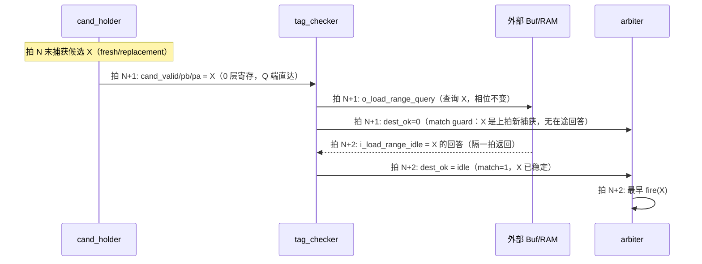

# A-004 v4 tag 查询两拍契约改造 · 结果与寄存器层数分析

> 汇报材料 · LFSM（4EU UU mode）PyCircuit V6 设计
> 事项：tag_checker `o_load_range_query → i_load_range_idle` 由同拍组合回答改为
> "第一拍查询、第二拍返回"（A-004 v4），改造内容、测试结果实测、以及
> cand_holder 寄存输出两条扇出路径的寄存器层数（cycle-aware 视角）呈现
> 计划来源：[tag_checker_两拍查询契约改造计划](../../../../.cursor/plans/tag_checker_两拍查询契约改造_2066cd31.plan.md)
> 实例代码：`designs/LFSM/pycircuit/lfsm/`、`designs/LFSM/pycircuit/tests/`
> 整理日期：2026-10-16

---

## 1. 背景与动机

原 A-004 相位契约（[ASSUMPTIONS.md](../docs/ASSUMPTIONS.md) A-004 节、
[PORT_LIST.md](../docs/PORT_LIST.md) §5.2）：`o_load_range_query` 出模块后，
外部 Buf/RAM **同拍**组合算 idle、`i_load_range_idle` 当拍回来参与仲裁——
一个跨越模块边界的 cycle-0 组合环，被
[ALGORITHM_PIPELINED.md](../docs/ALGORITHM_PIPELINED.md) R1 段列为
"头号风险、不可内部切分"。

本次修订（A-004 v4）：query 第 N 拍发出、idle 作为第 N−1 拍查询的
**寄存储备回答**在第 N 拍采样（sync-RAM 读语义），同拍环断开，R1 前提解除。
`valid=0 ⟹ 回答 1` 规则保留；外部 `fresh_idle_guard` 两拍规则不受影响。



## 2. 修改内容逐条

| # | 文件 | 内容 | 位置 |
| :--- | :--- | :--- | :--- |
| 1 | [lfsm/tag_checker.py](../lfsm/tag_checker.py) | 新增 per-lane 查询上下文寄存器 `rq_cv`(1b)/`rq_pb`(8b)/`rq_pa`(6b)（上拍候选三元组） | [52-56 行](../lfsm/tag_checker.py#L52) |
| | | match guard + 两拍 `dest_ok`：`v ? (match ? idle : 0) : 1` | [67-81 行](../lfsm/tag_checker.py#L67) |
| | | cycle-1 无条件采样候选三元组 | [136-140 行](../lfsm/tag_checker.py#L136) |
| | | docstring 改写为 A-004 v4 契约 + 正确性论证 | [1-17 行](../lfsm/tag_checker.py#L1) |
| 2 | [lfsm/cand_holder.py](../lfsm/cand_holder.py) | 仅 docstring：D-006 稳态节奏改为"最早第 2 个 held 拍（1 fire/2拍 per lane）"；代码零改动 | [1-12 行](../lfsm/cand_holder.py#L1) |
| 3 | [docs/ASSUMPTIONS.md](../docs/ASSUMPTIONS.md) | A-004 节追加 v4 修订段（契约、guard、节奏、R1 解除、验证入口） | [212-226 行](../docs/ASSUMPTIONS.md#L212) |
| 4 | [lfsm/lfsm_top.py](../lfsm/lfsm_top.py) | **零改动**（`fw_dok` 仅送 arbiter，端口/连线不变） | — |

正确性论证（设计要点）：held candidate 稳定 ⇒ 第 2 拍起 match=1、在途回答与候选
对齐；capture 边（fresh/replacement）三元组必变 ⇒ guard 强制 `dest_ok=0`，屏蔽
在途陈旧默认 1；连续候选三元组相同仅可能 ring 回卷别名，回答描述同一物理
range，良性；`planned_advance=0`（split 续写）不查询、`dest_ok` 恒 1、无 guard 等待。

## 3. 寄存器层数分析（cycle-aware 视角）

cand_holder 的 `h_*` 寄存输出（cycle-0 Q 端）同时发往 arbiter 与 tag_checker，
改造后各路径层数对账：

| 路径 | 层数 | 性质 |
| :--- | :--- | :--- |
| `cand_valid/inst/rid` → arbiter（elig/18b key） | 0 | 纯组合直达 |
| `cand_valid/pb/pa` → tag_checker → `o_load_range_query` | 0 | 纯组合（查询相位不变） |
| 查询 → 回答（tag_checker 内 `rq_*`） | **1** | 显式 `domain.signal`（本次新增） |
| `dest_ok` → arbiter `elig` 与 `cand_valid` 汇合 | 0 | fw_* + `cas(cycle=0)` 重标，自动平衡被驯化 |
| **框架 `_v5_bal` 自动增补（全链路合计）** | **0** | MLIR 结构断言实测（§4.3） |

反事实：若去掉 `cas(cycle=0)` 纪律、让 dest_ok 携带 cycle-1 标签，框架会在
`elig = cand_valid & dest_ok` 汇合点沿 cand_valid/inst/rid 自动插 1 层
`_v5_bal`，且 `fire_consume`（cycle-1）回读 cand_holder（cycle-0）构成
"写周期 < 读周期"错误——因此这 1 层偏差必须显式放置在 tag_checker 内。

自动对齐机制 ↔ 框架代码（[compiler/frontend/pycircuit/v5.py](../../../../compiler/frontend/pycircuit/v5.py)）：

| 机制 | 代码位置 | 说明 |
| :--- | :--- | :--- |
| 周期标签 | `CycleAwareSignal.cycle`（v5.py:1228）；`cas(domain, w, cycle=0)`（v5.py:1890-1906） | 每信号携带逻辑周期 |
| 自动对齐触发点 | `CycleAwareSignal._align`（v5.py:1269-1295）：二元算子先取 `mx=max(cycle)` 再 `delay_to` | arbiter `elig` 的 `&` 链（[arbiter.py:52](../lfsm/arbiter.py#L52)）即本链路汇合检查点 |
| 自动增补执行 | `CycleAwareDomain.delay_to`（v5.py:389-414）：按周期差插 `_v5_bal_N` DFF | 层数 = to_cycle − from_cycle |
| vec/mux 对齐 | `CycleAwareDomain.vec`（v5.py:498）；`mux`（v5.py:1831） | `domain.vec(*dest_ok)` 同样对齐 |
| 跨模块周期溯源 | `submodule_input`（v5.py:1058-1106） | `h_*`（cycle 0）经 `domain.call` 直达 arbiter |
| 寄存器写端不补平衡 | `_to_wire`（v5.py:1039-1053）只解包不对齐 | 故纪律要求表达式全部 cycle-0 算完（[types.py](../lfsm/types.py) docstring） |

## 4. 测试结果（实测）

### 4.1 单元 TB：`tests/unit/test_tag_checker.py`（T-054…T-057 重定时）

- 运行：`python3 designs/LFSM/pycircuit/tests/unit/test_tag_checker.py` → **OK（UNIT_TB_PASS）**
- Mirror 新增 prev-triple 寄存（[104 行](../tests/unit/test_tag_checker.py#L104)）、
  两拍 dest_ok 镜像（[113-115 行](../tests/unit/test_tag_checker.py#L113)）；
  SCRIPT 重排为"新三元组 → 1 拍 guard（dest_ok=0）→ 稳定后 fire"
  （[73-93 行](../tests/unit/test_tag_checker.py#L73)）；final `load_ptr=[1,1,3,4]`
  与原断言一致（提交语义不变，仅时序后移）。

### 4.2 链路 TB：`tests/integration/test_cand_tck_arb_pipe.py`（新建）

cand_holder + tag_checker + arbiter 按 [lfsm_top.py:184-227](../lfsm/lfsm_top.py#L184)
同款 fw 线组合，assembler 以 `view_next_*` 直驱 stub。
运行：`python3 designs/LFSM/pycircuit/tests/integration/test_cand_tck_arb_pipe.py`
→ **OK（CHAIN_TB_PASS）**。场景逐条：

| 场景 | 周期证据（TB 逐拍 expect 通过） | 结论 |
| :--- | :--- | :--- |
| a) fresh guard | c0 捕获 X → c1 `idle=0xF` 仍 `fire=0` → c2 fire X | 陈旧默认 1 被 guard 屏蔽 |
| b) replacement 节奏 | c5 fire Y + 捕获 Z → c6 guard `fire=0` → c7 fire Z | per-lane 1 fire/2 拍 |
| c) busy→idle | c9/c10 `idle2=0` `fire=0` → c11 `idle=1` fire W | busy 期间全保持，回答隔拍生效 |
| d) 双 lane 同边捕获 | c13 双 guard `fire=0` → c14 fire A（min key）→ c15 fire B | arbiter 聚合 1 fire/拍保持 |

### 4.3 MLIR 结构断言（层数分析固化）

`test_cand_tck_arb_pipe_mlir_clean` + `test_tag_checker_mlir_clean` 均通过；链路
MLIR（887 行）实测：

```
BAL_COUNT 0                                   # _v5_bal 自动增补 = 0 层（全链路）
lfsm_pipe_tck_rq_cv : vector<4xi1> (+__next)  # 查询上下文 1 层显式寄存器
lfsm_pipe_tck_rq_pb : vector<4xi8> (+__next)
lfsm_pipe_tck_rq_pa : vector<4xi6> (+__next)
```

即：**cand_holder→arbiter 直达路径自动对齐 0 层；查询→回答路径恰好 1 层显式
寄存器；框架 `_v5_bal` 全链路 0 插入**——§3 的对账表被结构断言固化。

### 4.4 单元回归

`pytest designs/LFSM/pycircuit/tests/unit -q` → **28 passed in 398.55s**
（14/14 文件 × mlir_clean + tb；cand_holder/arbiter/reset 等未受影响）。

## 5. 影响与后续项

- **节奏**：fresh/replacement 候选最早 fire = 第 2 个 held 拍（原可首拍 fire），
  per-lane 连发 1 fire/2 拍（D-006 文档化节奏已同步改注）；arbiter 跨 lane 聚合
  仍 1 fire/拍（链路场景 d 实证）。单 lane 长流场景吞吐减半，多 lane 交织无感。
- **后续（本次未做）**：
  1. 集成 TB（[test_bypass_chain.py](../tests/integration/test_bypass_chain.py) /
     [test_backpressure.py](../tests/integration/test_backpressure.py) /
     [test_replay_typical.py](../tests/integration/test_replay_typical.py)）idle
     应答改为打一拍模型 + query/fire 时相期望平移（链首 +2 → +3）与 golden 向量再生成；
  2. A-004 全量文档同步：[PORT_LIST.md](../docs/PORT_LIST.md) §5.1/§5.2、
     [ALGORITHM_CYCLE_AWARE_PSEUDOCODE.md](../docs/ALGORITHM_CYCLE_AWARE_PSEUDOCODE.md) §10、
     [ALGORITHM_SEQUENTIAL.md](../docs/ALGORITHM_SEQUENTIAL.md) `tck_eval`、
     [FEATURE_LIST.md](../docs/FEATURE_LIST.md) F-083、
     [TEST_PLAN.md](../docs/TEST_PLAN.md) T-054…T-057、pipeline 报告 R1 再评估
     （同拍环→两拍环，关键路径缩短收益量化）。

## 6. 链接索引

| 类别 | 条目 |
| :--- | :--- |
| 修改 RTL | [lfsm/tag_checker.py](../lfsm/tag_checker.py)、[lfsm/cand_holder.py](../lfsm/cand_holder.py)（docstring） |
| 契约文档 | [docs/ASSUMPTIONS.md](../docs/ASSUMPTIONS.md) A-004 v4 段（212-226） |
| 测试 | [tests/unit/test_tag_checker.py](../tests/unit/test_tag_checker.py)、[tests/integration/test_cand_tck_arb_pipe.py](../tests/integration/test_cand_tck_arb_pipe.py) |
| 框架机制 | [compiler/frontend/pycircuit/v5.py](../../../../compiler/frontend/pycircuit/v5.py)（_align:1269 / delay_to:389 / vec:498 / cas:1890 / submodule_input:1058） |
| 计划 | [tag_checker_两拍查询契约改造](../../../../.cursor/plans/tag_checker_两拍查询契约改造_2066cd31.plan.md) |
| 背景 | [V6 周期感知设计体现](V6周期感知_CycleAware设计_LFSM代码体现.md) §8（R1 同拍环原状）、[pipeline 划分评估](pipeline划分修改工作记录与下一步方向评估.md) R1 段 |
