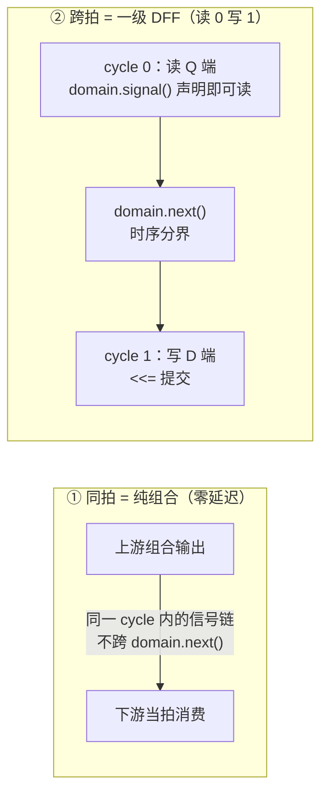
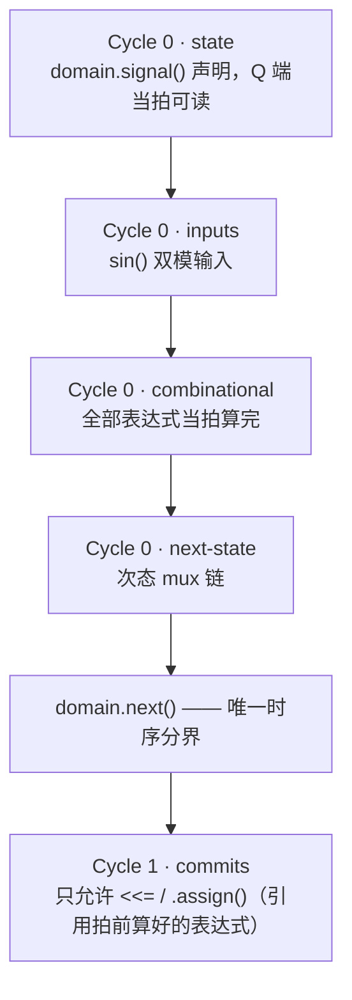
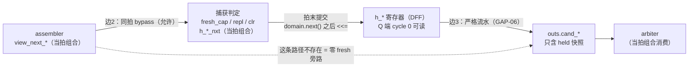
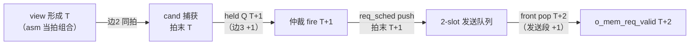

# Cycle-Aware 如何实现 Pipeline 对齐 —— cand_holder 实例图解

> 汇报材料 · LFSM（4EU UU mode）PyCircuit V6 设计
> 事项：用一个最小完整例子（cand_holder，边3 严格流水 / GAP-06）图解 V6
> 周期感知（Cycle-Aware）实现 pipeline 对齐的机制——两条对齐词汇、三段代码、
> 逐拍时序、测试侧镜像、纪律保障，以及全链 +2 拍相移的合成
> 权威来源：[docs/v6_PyCircuit_Specification.md](../../../../docs/v6_PyCircuit_Specification.md)（§2/§4/§6）、
> [docs/TEST_PLAN.md](../docs/TEST_PLAN.md) §0.4（链首相移口径）
> 姊妹篇：[V6周期感知_CycleAware设计_LFSM代码体现.md](V6周期感知_CycleAware设计_LFSM代码体现.md)（九体现点总览）
> 实例代码：`designs/LFSM/pycircuit/lfsm/cand_holder.py`、`designs/LFSM/pycircuit/tests/unit/test_cand_holder.py`
> 整理日期：2026-10-16

---

## 1. 一句话结论

**Pipeline 对齐 = 选择"读在哪一拍、写落在哪一拍"。** cand_holder 把 fresh
candidate 的捕获写在 cycle 1（`domain.next()` 之后 `<<=` 提交）、把对仲裁的
呈现放在 cycle 0（held 寄存器 Q 端直出）——读写周期差 1，编译器推导出一级
DFF，"形成拍仅供捕获、次拍起参与仲裁"这条契约就此落地；全程没有出现一次
"寄存器"或"延迟"字样。

---

## 2. 对齐词汇：只有两条

图 1 · cycle-aware 的全部对齐词汇：



- 同一 cycle 内的信号链天然是零延迟组合穿透 → **同拍 bypass 不需要任何
  特殊语法**；
- 写动作（cycle 1 `<<=`）比读动作（cycle 0 读 Q）晚一拍 → 编译器按周期差
  推导寄存器 → **流水级也不需要任何"寄存器"语句**。

**数法：`domain.next()` 的次数 = 寄存器级数；`<<=` 出现在哪个 cycle =
寄存器插在哪。** 全设计 13 个带状态叶模块每模块恰好 1 次
（[周期体现报告](V6周期感知_CycleAware设计_LFSM代码体现.md) §3），且每个模块都是同一个
四段式骨架（以 [walker](../lfsm/walker.py) 为样板）：

图 2 · 统一周期范式（四段式骨架）：



---

## 3. 选例：cand_holder —— 一个模块看完两种对齐

为什么选它：约 120 行、单一职责，且**进边（边2）是同拍组合、出边（边3）
是跨拍寄存**——两条对齐词汇在同一个模块里各出现一次，对照阅读即可建立
直觉。

图 3 · cand_holder 结构与两条边的对齐契约：



规格契约写在 docstring 里（一句话：仲裁只看 held 快照，fresh 次拍起参与）：

> [lfsm/cand_holder.py:1-12](../lfsm/cand_holder.py#L1)（docstring）

```python
"""LFSM cand_holder — held candidate lifetime + seq/planned latch (CYCLE §9).

Edge-3 strict pipeline (D-006): arbitration sees only the held snapshot —
a fresh candidate is captured at cycle end and participates from the next
cycle (chain head +1); fire-replacement is captured same-cycle.  Under the
A-004 v4 two-phase destination query (tag_checker), the dest_ok answer
lands one held-cycle later, so the earliest fire/refire is the candidate's
second held cycle ..."""
```

---

## 4. 三段代码拆解

### ① 对齐保证可一眼审查：outs 全是 held Q 端

> [lfsm/cand_holder.py:62-71](../lfsm/cand_holder.py#L62)

```python
    # ── Cycle 0: present = held snapshot (no fresh bypass) ─────────
    outs = dict(
        cand_valid=h_v,
        cand_inst=h_ins,
        cand_rd_mem_id=h_rid,
        cand_seq=h_seq,
        cand_planned_base=h_pb,
        cand_planned_advance=h_pa,
        dbg_cseq=cseq,
    )
```

6 个 `cand_*` 输出全部来自 `h_*`（`domain.signal` 声明的 DFF Q 端），
**没有一个键来自当拍组合输入 `view_*`**。下游 arbiter 在 cycle 0 组合消费
这些输出，因此它天然只能看到"上一拍末提交"的值——"次拍起参与仲裁"不需要
任何守卫逻辑，它是数据结构（Q 端直出）的直接后果。
**审查方式 = 读 outs 的每个值是否全部 `h_*` 寄存器（一条 grep 完成）。**

### ② 捕获逻辑：边2 同拍消费（cycle 0 组合）

> [lfsm/cand_holder.py:80-85](../lfsm/cand_holder.py#L80)

```python
    fresh_cap = (~fire_consume) & (~h_v) & view_next_formable
    repl = fire_consume & view_next_formable

    clr = fire_consume & (~view_next_formable)
    set_ = view_next_formable & (fire_consume | (~h_v))
    h_v_nxt = mux(clr, u(1, 0), mux(set_, u(1, 1), h_v))
```

`view_next_formable` 是上游 assembler 的**当拍组合输出**——同一 cycle 内不
跨 `domain.next()`，捕获判定当拍用它（边2 同拍 bypass）。注意对照：同一拍
里，`view_next_*` 可以被**捕获判定**消费，却不能被 **outs** 消费——
"谁能同拍看谁"正是由周期位置精确表达的。

### ③ 唯一时序分界 + 拍末统一提交

> [lfsm/cand_holder.py:106-115](../lfsm/cand_holder.py#L106)

```python
    domain.next()

    # ── Cycle 1: commits ───────────────────────────────────────────
    h_v <<= h_v_nxt
    h_ins <<= h_ins_nxt
    h_rid <<= h_rid_nxt
    h_pb <<= h_pb_nxt
    h_pa <<= h_pa_nxt
    h_seq <<= h_seq_nxt
    cseq <<= cseq_nxt
```

---

## 5. 逐拍时序：+1 对齐如何发生

图 4 · 形成拍 / 参与拍 逐拍过程：

```text
拍         组合求值（沿前，cycle 0 语义）              outs.cand_*        arbiter 视角
─────────  ─────────────────────────────────────────  ────────────────  ─────────────────────
T (形成拍)  view_next_formable=1；捕获判定当拍算出     旧值（上一候选/     看不到新候选
            h_*_nxt=新候选；outs 仍是旧 h_* Q 端        或无效）           ← 对齐保证
─────────  时钟沿：h_* <<= h_*_nxt（cycle 1 提交）  ────────────────────────────────────────
T+1(参与拍) held 快照 = 新候选                         新候选              首次看到：split 候选
                                                                           可当拍 fire；alloc
                                                                           候选按 A-004 v4 待
                                                                           dest_ok 回答
```

**代码里没有任何一行"打一拍"——+1 级流水是"读 cycle 0 / 写 cycle 1"的
周期差推导结果。** 若改成同拍直通（边2 式），把 outs 的键换成当拍组合表达式
即可；若再加一级，把呈现再推过一个 `domain.next()`——对齐调整是周期标注的
移动，不是网表手术。

---

## 6. 测试侧：TB 是这个对齐的镜像

T-050 把图 4 的时间线写进期望值——c0 驱动捕获、期望值相对驱动显式 +1 拍：

> [tests/unit/test_cand_holder.py:54-56](../tests/unit/test_cand_holder.py#L54)

```python
    # ── T-050: fresh capture (formable at cycle end, no fire) ──────
    _c(vnf=1, vni=2, vnr=5, vna=1, lp=10),           # c0: capture @edge
    _c(),                                            # c1: held(inst2,rid5,seq0,pb10,pa1)
```

两层镜像关系：

- **Python mirror 与 RTL 同构**（[同文件:92-117](../tests/unit/test_cand_holder.py#L92)）：
  `step()` "先返回沿前期望输出、再提交"——`exp` 取旧 `h_*`，随后才按
  fresh/repl/clr 更新，与设计的"cycle 0 读 Q / cycle 1 写 D"一一对应；
- **观测相位对应**：全部 `expect(..., phase="pre")`（沿前观测，TB 循环
  [128-149](../tests/unit/test_cand_holder.py#L128)）↔ 设计"cycle 0 组合 /
  cycle 1 提交"的相位。

即：设计的"写落在 cycle 1" = TB 的"期望值 +1 拍"——对拍口径与代码周期
结构互为镜像。

---

## 7. 纪律保障：+1 级是设计决策，不许编译器改

- **authoring 纪律**（[lfsm/types.py:1-8](../lfsm/types.py#L1) docstring）：所有表达式在
  `domain.next()` 之前算完，之后只允许 `<<=`/`.assign()`——自动周期平衡
  （`_v5_bal`）被驯化为零插入；
- **结构断言固化**（[test_cand_holder.py:157-160](../tests/unit/test_cand_holder.py#L157)）：

```python
def test_cand_holder_mlir_clean():
    mlir = compile_cycle_aware(build, name="tb_cand_holder_top", eager=True).emit_mlir()
    assert "func.func" in mlir
    assert "_v5_bal" not in mlir
```

pipeline 级数从源码数出来即所得，编译器不会"帮忙"插拍。

---

## 8. 全链视图：链首 +2 拍相移（TEST_PLAN §0.4 口径）

cand_holder 的 +1 级（边3）与 req_sched 2-slot 发送队列的 +1 级（发送段）
合成全链恒定相移：

图 5 · 三拍分段（T 形成 / T+1 grant / T+2 issue）：



[TEST_PLAN](../docs/TEST_PLAN.md) §0.4 原文："每条 candidate 链首相对 golden
恒定 **+2 拍**（边3 +1、发送段 +1）"，集成 TB 期望值按此整形（逐笔等价 +
链首相移，不做原始拍号逐拍等价）。

> 相位细节注：allocation 候选（advance>0）在 A-004 v4 两拍查询契约下，
> fire 还需再等 `dest_ok` 回答（最早第二个 held 拍）；该代价及 D1 投机查询
> 回收探索见 [A-004 v4 报告](A-004v4_tag查询两拍契约_改造结果与寄存器层数分析.md) 与
> [pipeline 再探索](pipeline划分再探索_rdqueue到rdMEM_自动对齐作用.md)。

---

## 9. 一屏速查

| 问题 | 答案（代码证据） |
| :--- | :--- |
| 对齐词汇有几条？ | 两条：同拍=组合、跨拍=`domain.next()`+`<<=`（[types.py:1-8](../lfsm/types.py#L1)） |
| 寄存器在哪？ | 读 cycle 0 / 写 cycle 1 ⟹ 一级 DFF（[cand_holder.py:41-47](../lfsm/cand_holder.py#L41) 声明 + [106-115](../lfsm/cand_holder.py#L106) 提交） |
| +1 对齐保证怎么审？ | outs 每个键都是 `h_*` Q 端，零 fresh 旁路（[cand_holder.py:62-71](../lfsm/cand_holder.py#L62)） |
| 同拍消费长什么样？ | 捕获判定当拍用 `view_next_*`（[cand_holder.py:80-85](../lfsm/cand_holder.py#L80)，边2） |
| TB 怎么对拍？ | 期望值 +1 拍 + `phase="pre"`（[test_cand_holder.py:54-56](../tests/unit/test_cand_holder.py#L54)） |
| 级数会被编译器改吗？ | 不会：纪律 + `_v5_bal` 零插入断言（[test_cand_holder.py:157-160](../tests/unit/test_cand_holder.py#L157)） |
| 全链相移多少？ | 链首恒定 +2 拍（边3 +1、发送段 +1，[TEST_PLAN](../docs/TEST_PLAN.md) §0.4） |

---

## 10. 相关文档索引

| 材料 | 位置 |
| :--- | :--- |
| 周期感知语言定义 | [docs/v6_PyCircuit_Specification.md](../../../../docs/v6_PyCircuit_Specification.md) §2/§4/§6 |
| 九体现点总览（姊妹篇） | 同目录[《V6周期感知_CycleAware设计_LFSM代码体现.md》](V6周期感知_CycleAware设计_LFSM代码体现.md) |
| 逐拍伪码（Step 6 定稿） | [designs/LFSM/pycircuit/docs/ALGORITHM_CYCLE_AWARE_PSEUDOCODE.md](../docs/ALGORITHM_CYCLE_AWARE_PSEUDOCODE.md) |
| 三拍分段决策与估算 | 同目录[《pipeline划分修改工作记录与下一步方向评估.md》](pipeline划分修改工作记录与下一步方向评估.md) |
| A-004 v4 两拍契约与寄存器层数 | 同目录[《A-004v4_tag查询两拍契约_改造结果与寄存器层数分析.md》](A-004v4_tag查询两拍契约_改造结果与寄存器层数分析.md) |
| 链首相移口径 | [designs/LFSM/pycircuit/docs/TEST_PLAN.md](../docs/TEST_PLAN.md) §0.4 |
| 实例代码 | `designs/LFSM/pycircuit/lfsm/cand_holder.py`、`designs/LFSM/pycircuit/tests/unit/test_cand_holder.py` |
