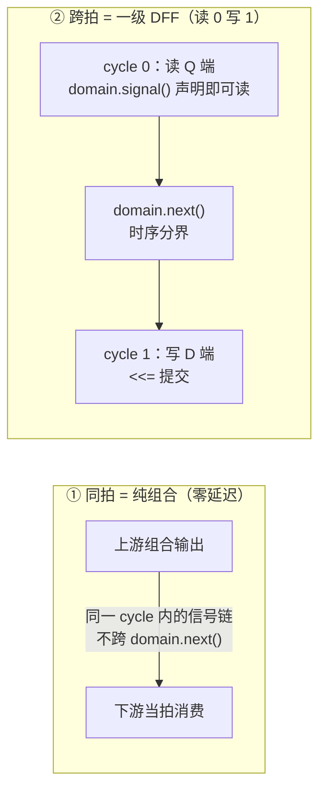
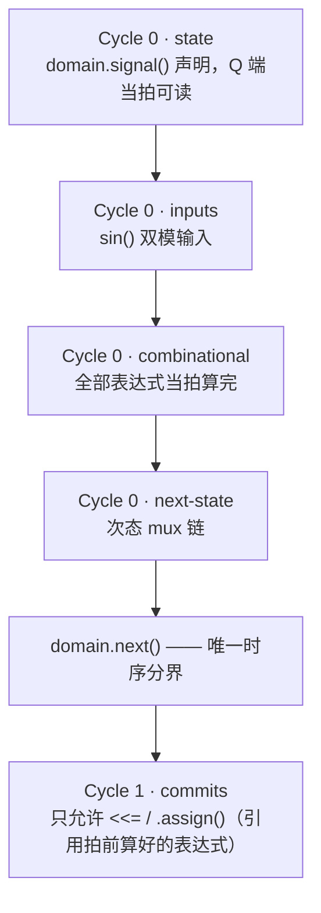
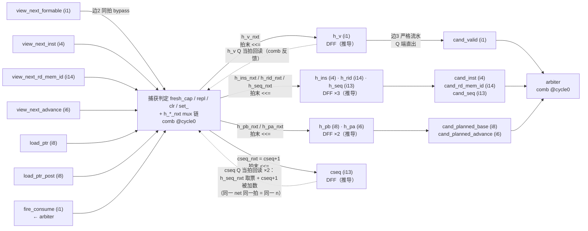

# Cycle-Aware 如何实现 Pipeline 对齐 —— cand_holder 实例图解

> 汇报材料 · LFSM（4EU UU mode）PyCircuit V6 设计
> 事项：用一个最小完整例子（cand_holder，边3 严格流水 / GAP-06）图解 V6
> 周期感知（Cycle-Aware）实现 pipeline 对齐的机制——两条对齐词汇、三段代码、
> 逐拍时序、测试侧镜像、纪律保障、全链 +2 拍相移的合成，以及加寄存器对齐
> 的三条原理（§9，只谈跨拍）
> 权威来源：[docs/v6_PyCircuit_Specification.md](../../../../docs/v6_PyCircuit_Specification.md)（§2/§4/§6）、
> [docs/TEST_PLAN.md](../docs/TEST_PLAN.md) §0.4（链首相移口径）
> 姊妹篇：[V6周期感知_CycleAware设计_LFSM代码体现.md](V6周期感知_CycleAware设计_LFSM代码体现.md)（九体现点总览）
> 实例代码：`designs/LFSM/pycircuit/lfsm/cand_holder.py`、`designs/LFSM/pycircuit/tests/unit/test_cand_holder.py`
> 整理日期：2026-10-16

---

## 1. 一句话结论

**Pipeline 对齐 = 选择"读在哪一拍、写落在哪一拍"。** cand_holder 把 fresh
candidate 的捕获写在 cycle 1（`domain.next()` 之后 `<<=` 提交）、把对仲裁的
呈现放在 cycle 0（held 寄存器 Q 端直出）——读写周期差 1，编译器推导出一级
DFF，"形成拍仅供捕获、次拍起参与仲裁"这条契约就此落地；全程没有出现一次
"寄存器"或"延迟"字样。

---

## 2. 对齐词汇：只有两条

图 1 · cycle-aware 的全部对齐词汇：



- 同一 cycle 内的信号链天然是零延迟组合穿透 → **同拍 bypass 不需要任何
  特殊语法**；
- 写动作（cycle 1 `<<=`）比读动作（cycle 0 读 Q）晚一拍 → 编译器按周期差
  推导寄存器 → **流水级也不需要任何"寄存器"语句**。

**数法：`domain.next()` 的次数 = 寄存器级数；`<<=` 出现在哪个 cycle =
寄存器插在哪。** 全设计 13 个带状态叶模块每模块恰好 1 次
（[周期体现报告](V6周期感知_CycleAware设计_LFSM代码体现.md) §3），且每个模块都是同一个
四段式骨架（以 [walker](../lfsm/walker.py) 为样板）：

图 2 · 统一周期范式（四段式骨架）：



---

## 3. 选例：cand_holder —— 一个模块看完两种对齐

为什么选它：约 120 行、单一职责，且**进边（边2）是同拍组合、出边（边3）
是跨拍寄存**——两条对齐词汇在同一个模块里各出现一次，对照阅读即可建立
直觉。

图 3 · cand_holder 硬件原理图（全部真实信号名 + 位宽；与
[toy 教程](V6_CycleAware入门_玩具流水线与LFSM对照.md) §2 同款画法）：



读图要点：从左侧 assembler 输入到右侧 `cand_*` 输出之间**没有任何直连
线**——"零 fresh 旁路"在原理图上就是那根不存在的线：输出全部接在 DFF
Q 端上（对应 outs 字典 6 个键全是 `h_*`，§4①）。7 个 DFF =
[cand_holder.py:41-47](../lfsm/cand_holder.py#L41) 的 7 个 `domain.signal()`
声明；虚线反馈 = 组合穿透寄存器 Q 端当拍回读（与 toy `dbg_prod` 同型）。
cseq 那路虚线是**一路两读**：`h_seq_nxt` 取票与 `cseq+1` 被加数读的是同一
Q net 在同一拍的同一个值 n——n+1 只存在于指向 D 端的 `cseq_nxt` 线网上，
CS 块就是周期边界（左 Q 右 D），"同拍同值"在图上是结构性事实而非注释。

规格契约写在 docstring 里（一句话：仲裁只看 held 快照，fresh 次拍起参与）：

> [lfsm/cand_holder.py:1-12](../lfsm/cand_holder.py#L1)（docstring）

```python
"""LFSM cand_holder — held candidate lifetime + seq/planned latch (CYCLE §9).

Edge-3 strict pipeline (D-006): arbitration sees only the held snapshot —
a fresh candidate is captured at cycle end and participates from the next
cycle (chain head +1); fire-replacement is captured same-cycle.  Under the
A-004 v4 two-phase destination query (tag_checker), the dest_ok answer
lands one held-cycle later, so the earliest fire/refire is the candidate's
second held cycle ..."""
```

---

## 4. 三段代码拆解

### ① 对齐保证可一眼审查：outs 全是 held Q 端

> [lfsm/cand_holder.py:62-71](../lfsm/cand_holder.py#L62)

```python
    # ── Cycle 0: present = held snapshot (no fresh bypass) ─────────
    outs = dict(
        cand_valid=h_v,
        cand_inst=h_ins,
        cand_rd_mem_id=h_rid,
        cand_seq=h_seq,
        cand_planned_base=h_pb,
        cand_planned_advance=h_pa,
        dbg_cseq=cseq,
    )
```

6 个 `cand_*` 输出全部来自 `h_*`（`domain.signal` 声明的 DFF Q 端），
**没有一个键来自当拍组合输入 `view_*`**。下游 arbiter 在 cycle 0 组合消费
这些输出，因此它天然只能看到"上一拍末提交"的值——"次拍起参与仲裁"不需要
任何守卫逻辑，它是数据结构（Q 端直出）的直接后果。
**审查方式 = 读 outs 的每个值是否全部 `h_*` 寄存器（一条 grep 完成）。**

### ② 捕获逻辑：边2 同拍消费（cycle 0 组合）

> [lfsm/cand_holder.py:80-85](../lfsm/cand_holder.py#L80)

```python
    fresh_cap = (~fire_consume) & (~h_v) & view_next_formable
    repl = fire_consume & view_next_formable

    clr = fire_consume & (~view_next_formable)
    set_ = view_next_formable & (fire_consume | (~h_v))
    h_v_nxt = mux(clr, u(1, 0), mux(set_, u(1, 1), h_v))
```

`view_next_formable` 是上游 assembler 的**当拍组合输出**——同一 cycle 内不
跨 `domain.next()`，捕获判定当拍用它（边2 同拍 bypass）。注意对照：同一拍
里，`view_next_*` 可以被**捕获判定**消费，却不能被 **outs** 消费——
"谁能同拍看谁"正是由周期位置精确表达的。

### ③ 唯一时序分界 + 拍末统一提交

> [lfsm/cand_holder.py:106-115](../lfsm/cand_holder.py#L106)

```python
    domain.next()

    # ── Cycle 1: commits ───────────────────────────────────────────
    h_v <<= h_v_nxt
    h_ins <<= h_ins_nxt
    h_rid <<= h_rid_nxt
    h_pb <<= h_pb_nxt
    h_pa <<= h_pa_nxt
    h_seq <<= h_seq_nxt
    cseq <<= cseq_nxt
```

---

## 5. 逐拍时序：+1 对齐如何发生

图 4 · 逐拍信号视图（与 [toy 教程](V6_CycleAware入门_玩具流水线与LFSM对照.md) §4
同款表格；取 T-050/T-053 实值：inst=2 / rid=5 / adv=1 / load_ptr=10）：

| cycle | `view_next_formable`<br/>（驱动） | `fresh_cap`<br/>（comb @cycle0） | `h_v` Q<br/>→ `cand_valid` | `h_ins` / `h_rid` Q<br/>→ `cand_inst` / `cand_rd_mem_id` | `h_pb` / `h_pa` Q<br/>→ `cand_planned_base` / `cand_planned_advance` | 事件 |
| :---: | :---: | :---: | :---: | :---: | :---: | :--- |
| T | 1（inst=2, rid=5,<br/>adv=1, lp=10） | **1** | 0 | – | – | 形成拍：捕获当拍算出；outs 仍是旧 Q 端，arbiter 看不到 ← 对齐保证 |
| T+1 | 0 | 0 | **1** | **2 / 5** | **10 / 1** | 参与拍：held 快照对 arbiter 可见（split 可当拍 fire；alloc 按 A-004 v4 待 dest_ok） |
| T+2…T+4 | 0 | 0 | 1（保持） | 2 / 5（保持） | 10 / 1（保持） | grant 被扣留 N 拍，held 稳定（T-053） |

读表要点：

- cycle T：`fresh_cap=1` 当拍可见 —— **同拍 = 纯组合**（边2）；
- cycle T+1：`h_*` Q 端出现上拍捕获值 —— **跨拍 = 寄存提交，次拍可见**（边3）；
- T+2 起：无 fire 时 Q 端保持不变 —— 保持不靠守卫逻辑，靠次态 mux 默认
  回读 Q（`h_v_nxt = mux(clr, 0, mux(set_, 1, h_v))` 的 else 分支）。

**代码里没有任何一行"打一拍"——+1 级流水是"读 cycle 0 / 写 cycle 1"的
周期差推导结果。** 若改成同拍直通（边2 式），把 outs 的键换成当拍组合表达式
即可；若再加一级，把呈现再推过一个 `domain.next()`——对齐调整是周期标注的
移动，不是网表手术。

---

## 6. 测试侧：TB 是这个对齐的镜像

T-050 把图 4 的时间线写进期望值——c0 驱动捕获、期望值相对驱动显式 +1 拍：

> [tests/unit/test_cand_holder.py:54-56](../tests/unit/test_cand_holder.py#L54)

```python
    # ── T-050: fresh capture (formable at cycle end, no fire) ──────
    _c(vnf=1, vni=2, vnr=5, vna=1, lp=10),           # c0: capture @edge
    _c(),                                            # c1: held(inst2,rid5,seq0,pb10,pa1)
```

两层镜像关系：

- **Python mirror 与 RTL 同构**（[同文件:92-117](../tests/unit/test_cand_holder.py#L92)）：
  `step()` "先返回沿前期望输出、再提交"——`exp` 取旧 `h_*`，随后才按
  fresh/repl/clr 更新，与设计的"cycle 0 读 Q / cycle 1 写 D"一一对应；
- **观测相位对应**：全部 `expect(..., phase="pre")`（沿前观测，TB 循环
  [128-149](../tests/unit/test_cand_holder.py#L128)）↔ 设计"cycle 0 组合 /
  cycle 1 提交"的相位。

即：设计的"写落在 cycle 1" = TB 的"期望值 +1 拍"——对拍口径与代码周期
结构互为镜像。

---

## 7. 纪律保障：+1 级是设计决策，不许编译器改

- **authoring 纪律**（[lfsm/types.py:1-8](../lfsm/types.py#L1) docstring）：所有表达式在
  `domain.next()` 之前算完，之后只允许 `<<=`/`.assign()`——自动周期平衡
  （`_v5_bal`）被驯化为零插入；
- **结构断言固化**（[test_cand_holder.py:157-160](../tests/unit/test_cand_holder.py#L157)）：

```python
def test_cand_holder_mlir_clean():
    mlir = compile_cycle_aware(build, name="tb_cand_holder_top", eager=True).emit_mlir()
    assert "func.func" in mlir
    assert "_v5_bal" not in mlir
```

pipeline 级数从源码数出来即所得，编译器不会"帮忙"插拍。

---

## 8. 全链视图：链首 +2 拍相移（TEST_PLAN §0.4 口径）

cand_holder 的 +1 级（边3）与 req_sched 2-slot 发送队列的 +1 级（发送段）
合成全链恒定相移：

图 5 · 三拍分段全链（T 形成 / T+1 grant / T+2 issue，全部真实信号名）：

```mermaid
flowchart LR
    VN["assembler<br/>view_next_formable / view_next_inst /<br/>view_next_rd_mem_id / view_next_advance<br/>comb @cycle0 · 形成拍 T"] -->|"边2 同拍 bypass"| CHD["cand_holder 捕获判定<br/>fresh_cap / repl → h_*_nxt<br/>comb @cycle0"]
    CHD -->|"拍末 <<=（T 末沿）"| HQ["h_v / h_ins / h_rid /<br/>h_seq / h_pb / h_pa<br/>DFF（推导）"]
    HQ -->|"边3 +1：cand_valid / cand_inst /<br/>cand_rd_mem_id / cand_planned_*<br/>Q 端 @T+1"| ARB["arbiter<br/>fire / grant_lane / fire_consume<br/>comb @cycle0 · grant 拍 T+1"]
    ARB -->|"拍末 push：s_f / s_v / cnt <<=（T+1 末沿）"| RQP["req_sched 2-slot<br/>cnt / pr / pw DFF（推导）<br/>发送段 +1"]
    RQP -->|"front Q 且 i_shared_mem_ready ⇒ pop<br/>comb @cycle0 · issue 拍 T+2"| MEM["o_mem_req_valid (i1)<br/>o_mem_req_* payload /<br/>o_load_ptr_update_*"]
```



[TEST_PLAN](../docs/TEST_PLAN.md) §0.4 原文："每条 candidate 链首相对 golden
恒定 **+2 拍**（边3 +1、发送段 +1）"，集成 TB 期望值按此整形（逐笔等价 +
链首相移，不做原始拍号逐拍等价）。

> 相位细节注：allocation 候选（advance>0）在 A-004 v4 两拍查询契约下，
> fire 还需再等 `dest_ok` 回答（最早第二个 held 拍）；该代价及 D1 投机查询
> 回收探索见 [A-004 v4 报告](A-004v4_tag查询两拍契约_改造结果与寄存器层数分析.md) 与
> [pipeline 再探索](pipeline划分再探索_rdqueue到rdMEM_自动对齐作用.md)。

---

## 9. 加寄存器对齐的原理（只谈跨拍）

本节只回答一个问题：**图 3 / 图 5 里每一路为什么是这个寄存器级数**——
不涉及拍内组合深度，只用一把尺：**跨拍长度 = 这条路穿过几级寄存器 =
值要等几拍才被消费**。推导规则一句话：值的生命周期跨过几个周期边界，
就推导几级 DFF；活不过一拍的事件，零推导。

### 9.1 图 3 各路跨拍长度点名

| # | 路径 | 跨拍 | 对齐含义 |
| :- | :--- | :-: | :--- |
| ① | `view_next_*` → 捕获判定 → `h_*` D 端（边2 进路） | 0 级（末端被捕获） | 契约**允许**同拍：当拍形成的信息当拍可被捕获，路上零寄存 |
| ② | `load_ptr` / `load_ptr_post` → `h_pb` D | 0 级 | 上游本就是寄存器 Q 端，过 mux 即达；两条输入对应"形成前/后指针"两种提交语义 |
| ③ | `h_v` Q ⇢ 捕获判定 → `h_v` D（自反馈） | 1 级 | 状态寄存器的固有形态：Q 经少量逻辑回 D，一拍一更新 |
| ④ | `cseq` Q → `cseq` D；`cseq` Q → `h_seq` D | 1 级 | 计数器与快照是**两种生命周期**：前者跨指令永续累加，后者随候选生灭——不能共用，故两个 DFF |
| ⑤ | `h_*` Q → `cand_*` → arbiter → `fire_consume` → 捕获判定 → `h_*` D | 0 级 | 同拍反馈环：fire 当拍消费、当拍替换，环上**零寄存**——语义要求（见 §9.4） |
| ⑥ | `h_*` Q → `cand_*` 输出 | 0 级 | Q 端直出：边3 的"呈现"本身不花拍，那一拍在捕获时已经付过 |

### 9.2 原理一：生命周期决定推导数量

- `fresh_cap` / `repl` / `clr` 是**单拍事件**：本拍为真、下拍重算——
  存它没有意义，零推导；
- `h_*` 是**多拍持有**：grant 被扣留 N 拍，候选身份就要稳定活 N 拍
  （T-053 实证）——生命周期跨周期边界，推导一级 DFF；
- `cseq` 与 `h_seq` 同为 DFF 但理由不同：**计数器**（跨指令永续）与
  **快照**（随候选生灭）生命周期不同，不能共用寄存器。

### 9.3 原理二：每条"禁止同拍消费"的契约 = 强制 +1 级

边2"允许同拍"→ 路①零级；边3"fresh 不得当拍参与仲裁"→ `h_*` 强制一级。
这一级买到的是**独立决策窗口**：若允许 fresh 直通仲裁，"队列头 →
assembler 视窗 → 捕获 → 仲裁"会并入同一拍，形成窗口与仲裁窗口互相挤压；
插入一级后两个窗口各占一拍、互不依赖。**寄存器级数 = 把长链切成几段的
刀数**——每刀 +1 拍延迟，换每段独立的全拍预算。

### 9.4 原理三：寄存器插在环旁边，不插在环里（为什么恰好一级）

`fire_consume → 捕获（clr/repl）→ 次拍再 fire` 必须同拍闭合，否则每 lane
吞吐跌破 1 fire/拍的语义目标。**同拍反馈环内插寄存器 = 改语义（吞吐减半）**，
所以寄存器全部落在环的*旁边*——候选进环之前先落 `h_*`，环上（路⑤）
一级都没有。再加一级也不改善任何语义、只白送 +1 拍链首延迟——**恰好一级
是不伤吞吐前提下的最小解耦**。

### 9.5 全链：+2 = 两次解耦各付一刀

同一把尺量图 5：

- **边1（入队寄存）**：rdgen 突发生产（RD+END 同拍双写）与 assembler
  匀速消费解耦，FIFO 占数吸收速率差；
- **边3（`h_*` 一级）**：形成窗口 | 仲裁窗口切开（候选主路上的第一刀）；
- **发送段（req_sched 2-slot 一级）**：仲裁窗口 | 发射窗口切开，
  `mem_ready=0` 的反压够不到仲裁同拍环（主路上的第二刀）。

落刀原则全设计统一：**每刀都砍在两个决策窗口的接缝上，没有一刀砍进
同拍反馈环内部。**

### 9.6 一句话

跨拍长度 = 契约强制的等待数（每条"禁止同拍"的边 +1 级）；推导出的
寄存器数量 = 值的生命周期需要跨过的周期边界数——事件零推导、持有
推导一级，每刀砍在窗口接缝、不砍进同拍环。

---

## 10. 一屏速查

| 问题 | 答案（代码证据） |
| :--- | :--- |
| 对齐词汇有几条？ | 两条：同拍=组合、跨拍=`domain.next()`+`<<=`（[types.py:1-8](../lfsm/types.py#L1)） |
| 寄存器在哪？ | 读 cycle 0 / 写 cycle 1 ⟹ 一级 DFF（[cand_holder.py:41-47](../lfsm/cand_holder.py#L41) 声明 + [106-115](../lfsm/cand_holder.py#L106) 提交） |
| +1 对齐保证怎么审？ | outs 每个键都是 `h_*` Q 端，零 fresh 旁路（[cand_holder.py:62-71](../lfsm/cand_holder.py#L62)） |
| 同拍消费长什么样？ | 捕获判定当拍用 `view_next_*`（[cand_holder.py:80-85](../lfsm/cand_holder.py#L80)，边2） |
| TB 怎么对拍？ | 期望值 +1 拍 + `phase="pre"`（[test_cand_holder.py:54-56](../tests/unit/test_cand_holder.py#L54)） |
| 级数会被编译器改吗？ | 不会：纪律 + `_v5_bal` 零插入断言（[test_cand_holder.py:157-160](../tests/unit/test_cand_holder.py#L157)） |
| 全链相移多少？ | 链首恒定 +2 拍（边3 +1、发送段 +1，[TEST_PLAN](../docs/TEST_PLAN.md) §0.4） |
| 为什么有的路更多推导？ | 生命周期跨边界数 + 契约强制等待数；寄存器砍在窗口接缝、不进同拍环（§9） |

---

## 11. 相关文档索引

| 材料 | 位置 |
| :--- | :--- |
| 周期感知语言定义 | [docs/v6_PyCircuit_Specification.md](../../../../docs/v6_PyCircuit_Specification.md) §2/§4/§6 |
| 九体现点总览（姊妹篇） | 同目录[《V6周期感知_CycleAware设计_LFSM代码体现.md》](V6周期感知_CycleAware设计_LFSM代码体现.md) |
| 逐拍伪码（Step 6 定稿） | [designs/LFSM/pycircuit/docs/ALGORITHM_CYCLE_AWARE_PSEUDOCODE.md](../docs/ALGORITHM_CYCLE_AWARE_PSEUDOCODE.md) |
| 三拍分段决策与估算 | 同目录[《pipeline划分修改工作记录与下一步方向评估.md》](pipeline划分修改工作记录与下一步方向评估.md) |
| A-004 v4 两拍契约与寄存器层数 | 同目录[《A-004v4_tag查询两拍契约_改造结果与寄存器层数分析.md》](A-004v4_tag查询两拍契约_改造结果与寄存器层数分析.md) |
| 链首相移口径 | [designs/LFSM/pycircuit/docs/TEST_PLAN.md](../docs/TEST_PLAN.md) §0.4 |
| 实例代码 | `designs/LFSM/pycircuit/lfsm/cand_holder.py`、`designs/LFSM/pycircuit/tests/unit/test_cand_holder.py` |
