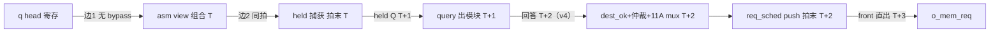
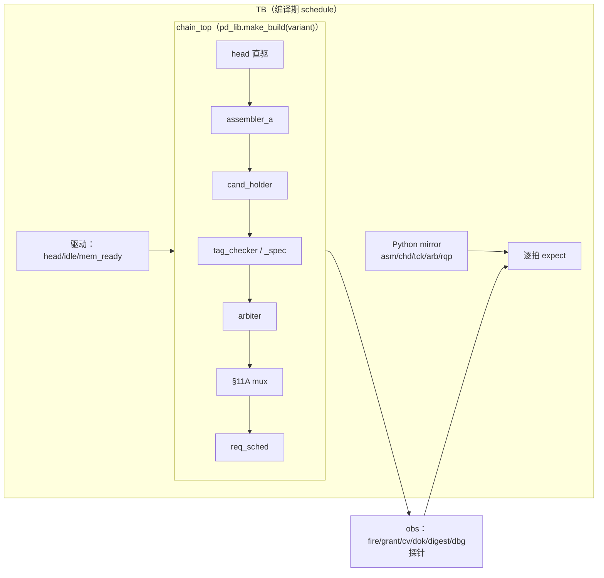
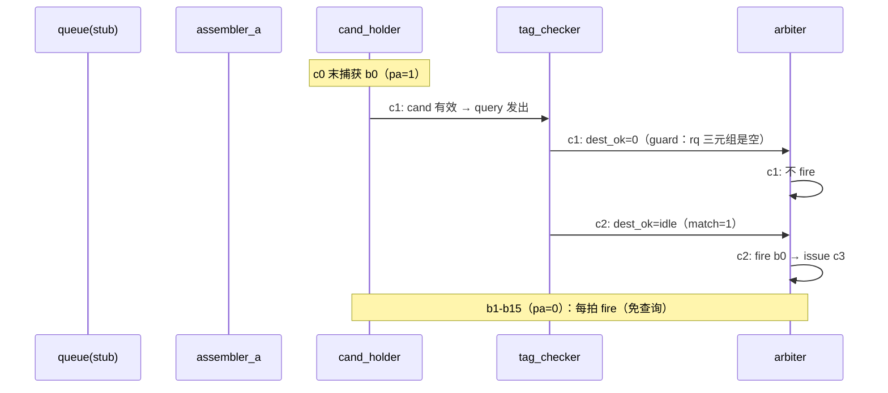
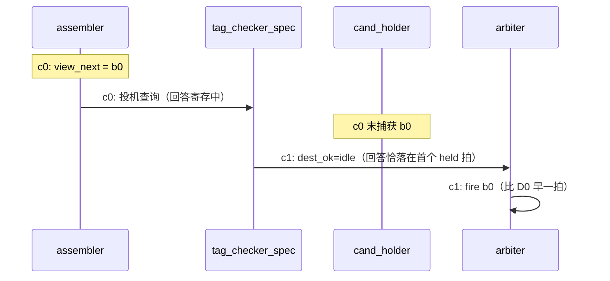
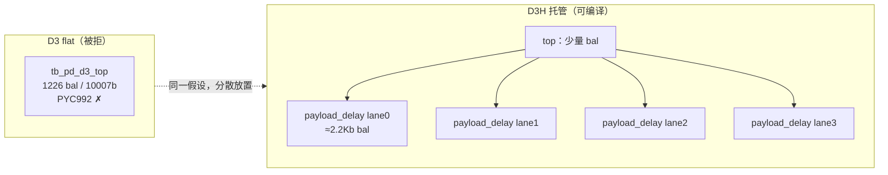

# Walkthrough：D1 探索全流程（pipeline 划分再探索实例）

> 汇报材料 · LFSM（4EU UU mode）PyCircuit V6 设计
> 事项：以 D1（投机查询）为主线，按探索的实际实现思路**从前到后逐步复现**整个
> pipeline 划分再探索——每次迭代给出：当时的结构图、代码变化、print 出的关键
> 数据变化（含失败的中间态，它们是探索最有信息量的部分）
> 结论报告：[pipeline划分再探索_rdqueue到rdMEM_自动对齐作用](pipeline划分再探索_rdqueue到rdMEM_自动对齐作用.md)
> 实验代码：`designs/LFSM/pycircuit/explore/pipe_div/`
> 整理日期：2026-10-16

---

## 迭代总览

| # | 迭代 | 目标 | 关键数据变化 | 结果 |
| :--- | :--- | :--- | :--- | :--- |
| 0 | 问题定义 | 量化 v4 代价 | 链首 +1 拍（alloc 候选） | 假设形成 |
| 1 | 基建：chain_top + mirror | D0 基线可编译可仿 | MLIR 11942 行 / `_v5_bal`=0 | 通过 |
| 2 | mirror 自检 | 纯 Python 模型对账 | lat 全 0（bug）→ `[2,1,1,…]`（修复） | 模型可信 |
| 3 | D0 TB | 基线硬件对拍 | 48 fire/48 issue 全绿 | 基线成立 |
| 4 | **D1 变体** | cap→fire 回到 1 拍 | lat `[1,1,1,…]`、寄存器 −56b | **成立** |
| 5 | D2/D3 对照 | 边界探索 | D2 +8788b；D3 PYC992；D3H 后端 bug | 对照结论 |
| 6 | 汇总 | 报告 + 回归 | pytest 28 passed | 交付 |

---

## 迭代 0：问题定义——v4 代价到底花在哪

A-004 v4 把 tag 查询从同拍改成两拍（第一拍查询、第二拍返回），R1 同拍环断开，
但引入新延迟。先把"代价"翻译成可测量的量：**候选从捕获（capture）到 fire 的拍数**。



形成的工作假设（三条，后续逐条验证）：

- H1：v4 代价可以用"投机查询"回收——查询从 assembler `view_next_*` 提前发出
  （与 cand_holder 捕获同源），回答恰好落在候选首个 held 拍；
- H2：R2 数据环（BMX payload 重算）可以用付运快照移出 grant 路径；
- H3：V6 自动周期平衡（`_v5_bal`）可以当探索仪器：重定时假设不用手写寄存器，
  让框架自动补全，再读它的放置方案。

## 迭代 1：基建——一条可参数化的链路 + 一个 A-lane 精确 mirror

**思路**：不做全 lfsm_top，把 rd_queue→…→req_sched 抽成可参数化 chain_top
（真 assembler×4 + cand_holder×4 + tag_checker×4 + arbiter + §11A mux + req_sched，
queue head 由 TB 直驱），变体只换零件。mirror 侧只精确建 A lane（语义最简单），
其余 lane 空闲。



新增文件：[pd_lib.py](../explore/pipe_div/pd_lib.py)（`make_build(variant)` 一个入口
换出 D0–D3H）、[tb_pd_common.py](../explore/pipe_div/tb_pd_common.py)（mirror + 驱动
+ expect 引擎）、四个薄 TB 壳。第一次 MLIR 编译检查：

```
D0 mlir OK, lines 11942 _v5_bal count 0     # 纪律基线：自动平衡零插入
```

## 迭代 2：mirror 自检——先让 Python 模型说对话

**思路**：硬件构建一次要几分钟，mirror 跑一遍只要毫秒——先纯 Python 跑通指标，
再上硬件。第一次跑 `tb_pd_common.py` 的独立指标（`metrics_only`）就露馅了：

```json
// 第一次（错误）：cap→fire 全是 0，fire 间隔 1——guard 根本没生效
{"variant": "D0", "cap_fire_min": 0, "lat_first10": [0, 0, 0, 0, 0, ...]}
```

**定位**：mirror 里 `lat.append((self.cap, cyc))` 写在 chd 提交**之后**——replacement
捕获先把 `cap` 覆盖成当前拍， fired 候选的捕获拍被吃掉。修复（[tb_pd_common.py](../explore/pipe_div/tb_pd_common.py)，
把 fired 候选的指标记录挪到捕获逻辑之前）后再跑：

```json
// 修复后：D0 的 block0 2 拍、block1-15 全 1 拍
{"variant": "D0", "fires": 48, "issues": 48,
 "lat_first10": [2, 1, 1, 1, 1, 1, 1, 1, 1, 4]}
```

**意外收获（本探索最重要的语义发现）**：A lane 一个 owner 16 个 block 里只有
block0（`advance=1`）付 v4 的 +1 拍；其余 15 个 split block（`advance=0`）依
A-004 语义本就不查 destination，首拍即 fire。**v4 代价 = per-allocation-候选
+1 拍，不是 per-lane 吞吐减半**。这个结论直接改变了后续变体的评估权重。

## 迭代 3：D0 TB——基线硬件对拍

上硬件前撞了一个低级但典型的错：薄 TB 壳的路径层级写错
（`_HERE.parents[2]` 应为 `parents[1]`）：

```
ModuleNotFoundError: No module named 'lfsm_tb_common'   ×4
```

修完后 D0 TB 全绿：48 fire / 48 issue 逐拍 expect（fire/grant/dest_ok/pop/
query_valid/room/payload 摘要/issue 字段）全对——**基线成立，mirror 与 DUT
在每一个可观测点同拍**。



## 迭代 4：D1 投机查询——把查询提前到捕获拍

**假设 H1 的实现**（[tag_checker_spec.py](../explore/pipe_div/tag_checker_spec.py)）：
查询源从 held 快照改为 `view_next_*`（和 cand_holder 捕获严格同源），planned_base
用 `fire_consume ? load_ptr_post : load_ptr` 内部 mux；回答寄存一拍：

```python
# 核心三行（tag_checker_spec.py 逐 lane）
will_cap = vnf[l] & (me | (~cand_valid[l]))           # 与 chd 捕获条件同源
v        = mux(will_cap, spec_pa_nz, cand_valid[l] & pa_nz)
dest_ok  = mux(rq_v[l], idle_in[l], u(1, 1))          # 无 match guard
```

pd_lib 里 D1 只是换 `tck_fn` + 多接 8 根 `view_next_*` 线；mirror 侧把 tck 公式换成
spec 版（`dok = idle if rqv else 1`）。先看纯 mirror：

```json
// D0 vs D1 的 cap→fire（mirror，毫秒级）
D0: "lat_first10": [2, 1, 1, 1, 1, 1, 1, 1, 1, 4]   // block0 被 guard 拖一拍
D1: "lat_first10": [1, 1, 1, 1, 1, 1, 1, 1, 1, 4]   // 全 1 拍——v4 代价消失
```

再上 MLIR 纪律检查 + TB：

```
D1 mlir OK, lines 11946 _v5_bal count 0      # 投机没破坏零插入纪律
TB_d1_PASS                                    # 48 fire/48 issue 全项对拍
```

时序对比图（D1 相对 D0 的变化）：



寄存器账（compile_stats 汇总）：D0 5712b → **D1 5656b（−56b）**——guard 三元组
寄存器（60b）换成 1 bit 在途有效位（4b），性能倒赚。**至此主线结论成立：
D1 以 −56b 回收 v4 全部延迟，功能全项验证。**

## 迭代 5：D2/D3 对照组——边界在哪里

**D2 付运快照**（[payload_snap.py](../explore/pipe_div/payload_snap.py)）：payload 每拍
采样，§11A mux 源改寄存器。TB 全绿，代价 +8788b（4 lane × 2197b），R2 数据环
移出 grant 路径——留作 Step 9 触发项。

**D3 框架自动重定时**（假设 H3 的实战）：payload 域整体标 cycle-1，不写一行
寄存器，让框架补。MLIR 层立竿见影：

```
D3 mlir OK, lines 19298 _v5_bal count 2452（去重 1226 个寄存器 / 10007 bit）
```

但 C++ 构建被拒——1226 个寄存器挤在一个 flat top 里超了硬预算：

```
error: [PYC992] hottest emitted module exceeds hard budget:
module=`tb_pd_d3_top` predicted_compile_cost=6.937165e+04 > 4.000000e+04
```

改托管形态 D3H（每 lane 一个小 `payload_delay` 模块装 bal，[payload_delay.py](../explore/pipe_div/payload_delay.py)，
cycle-1 零锚点 `live + cas(u(w,0), cycle=1)` 逼框架放寄存器）——编译过了，
但仿真连续踩坑，每个坑都变成一条设计/工具结论：

| 步骤 | 打印的错误 | 结论 |
| :--- | :--- | :--- |
| D3H 首跑 | `c3 f_issue_v got=1 exp=0`（issue 早一拍） | **框架只按组合点局部对齐**：cnt 路径 c0 不补、slot 写使能被 payload 拖到 c1 → push/data 不一致；`push_valid` 必须随 payload 一起重锚 |
| 修复后再跑 | `c4 f_i_key_seq got=1 exp=0`、`c4 f_i_upd_v got=0 exp=1` | 加 dbg 探针（cnt/pr/pw/push/pop/s0/s1）全部与 mirror 一致 |
| 矛盾定位 | `f_dbg_s0=0` ∧ `f_dbg_pr=0` ∧ `f_i_key_seq=1` 同拍同源 | 同步逻辑不可能 → **C++ 后端仿真求值 bug** |
| 对照实验 | 去掉 eval-cache 禁用宏重建：`*** stack smashing detected ***` | cache-on 直接崩溃；cache-off 残留不一致 → 上报 toolchain |



同一重定时假设，**"放哪"决定可编译性**——这反过来给 D2 的分散快照设计投了
一票；而 bal 密集电路当前无法被仿真门禁，又给生产侧 `_v5_bal=0` 纪律投了一票。

## 迭代 6：mirror 硬化与汇总

调试 D3H 过程中 mirror 也被迫对齐 DUT 的两个物理细节（否则探针误报）：

- `dbg_pr` 是寄存器（本拍 pop 之前的值），mirror 曾按"本拍 pop 之后"算 →
  `c3 f_dbg_pr got=0 exp=1`；
- req_sched 是**环形槽**（slot0/1 + pr/pw 指针，pop 不移内容），mirror 曾用
  移位队列建模 → `c4 f_dbg_s0 got=0 exp=1`。

改成环形槽后 D0/D1/D2 全探针复验全绿。最终汇总：

```
TB_d0_PASS / TB_d1_PASS / TB_d2_PASS
pytest designs/LFSM/pycircuit/tests/unit  →  28 passed（主 RTL 未动）
```

完整对比表落盘 [balance_report.md](../explore/pipe_div/balance_report.md)，
结论与落地建议落盘 [pipeline划分再探索_rdqueue到rdMEM_自动对齐作用](pipeline划分再探索_rdqueue到rdMEM_自动对齐作用.md)。

## 方法论沉淀（本次探索的操作清单）

1. **先量化代价再动手**：把"v4 变贵了"翻译成 `cap→fire` 拍数这个可测指标，
   才发现代价只在 allocation 候选（迭代 2 的意外发现改变了一切评估）。
2. **mirror 先行，硬件殿后**：毫秒级 mirror 自检（含故意跑错再修）先行，
   硬件 TB 只做最终对拍——本探索 90% 的模型 bug 在 Python 阶段解决。
3. **变体 = 只换零件**：chain_top 参数化让 D0–D3H 共享同一套驱动/期望，
   对照组之间只差一个模块或一个 cycle 标签。
4. **自动对齐当仪器不当产线**：重定时假设交给框架补拍，读 `_v5_bal` 放置
   做决策；定稿代码仍守 `_v5_bal=0`。
5. **失败中间态全留档**：PYC992、push 不一致、c4 自相矛盾——每个错误打印
   都转化成了设计准则或 toolchain issue，没有"失败"的迭代。

## 链接索引

| 类别 | 条目 |
| :--- | :--- |
| 探索代码 | [explore/pipe_div/](../explore/pipe_div/)（pd_lib / tag_checker_spec / payload_snap / payload_delay / tb_pd_common / tb_pd_d0..d3h） |
| 数据表 | [balance_report.md](../explore/pipe_div/balance_report.md) |
| 结论报告 | [pipeline划分再探索_rdqueue到rdMEM_自动对齐作用](pipeline划分再探索_rdqueue到rdMEM_自动对齐作用.md) |
| 前置改造 | [A-004 v4 改造结果](A-004v4_tag查询两拍契约_改造结果与寄存器层数分析.md) |
| 生产 RTL | [lfsm/tag_checker.py](../lfsm/tag_checker.py)、[lfsm/lfsm_top.py](../lfsm/lfsm_top.py) |
| 计划 | [pipeline划分再探索与自动对齐](../../../../.cursor/plans/pipeline_dccbaad9.plan.md) |
