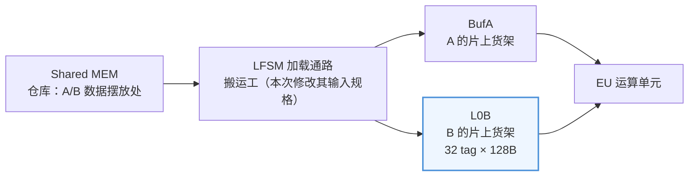
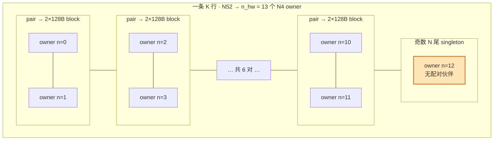
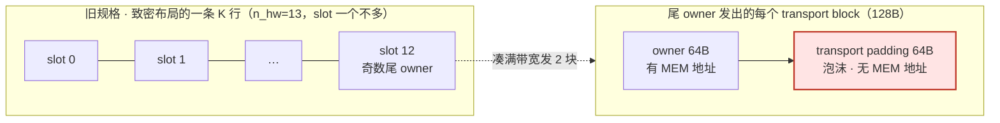
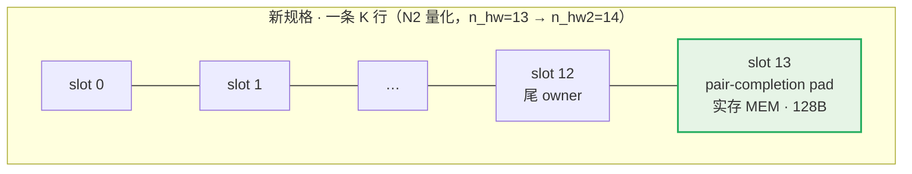
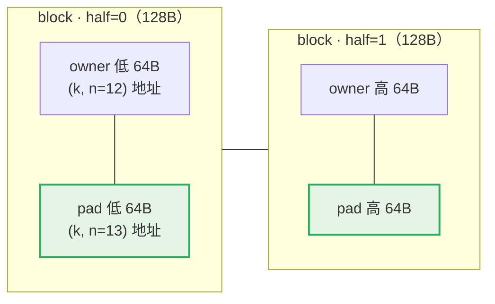

# L0B layout 输入规格修改工作记录

> 汇报材料 · LFSM 设计迭代
> 事项：B lane（plain B / L0B 通路）Shared MEM 布局输入规格由**致密行线性**改为 **N2 owner-pair 量化**
> 流程：`DOC_SYNC_QUEUE` candidate → 用户授权 → freeze & sync
> Freeze 日期：2026-10-14；状态：**已 freeze，规格/代码/V6 文档已同步，回归全绿**
> 权威原始记录：`designs/LFSM/design_spec/code/debug_records/20261014_112400_b_pair_quantized_layout.md`
> **读者预设：无本项目背景资料**——§2 为背景介绍（Mermaid 图示 + 伪代码 +
> 贯穿例子），先看 §2 再读其余章节。

---

## 1. 事项概述

| 项 | 内容 |
| :--- | :--- |
| 修改对象 | 原始 L0B layout 输入规格——B 数据在 Shared MEM 中的行布局与地址公式 |
| 触发来源 | V6 文档评审讨论的迭代发现：**B 奇数 N 尾 padding 在 MEM 中没有实存归属** |
| 修改结论 | B lane 采用与 BMX（2026-09-23 候选）相同的 N2 owner-pair 量化规则：行 slot 数 `n_hw2 = n_hw + (n_hw & 1)` |
| 用户授权 | 2026-10-14（显式指示「开始按 DOC_SYNC_QUEUE.md 修改」） |
| 影响面 | 规格文档 6 份 + V6 文档 4 份 + golden 参考模型 5 文件 + 测试 1 文件；8EU fork 不动 |

---

## 2. 背景介绍（零基础读者向）

### 2.1 这个系统在做什么

本设计是一款矩阵加速器（类 TPU）的**加载数据通路**，核心模块叫 **LFSM**
（Load FSM）。矩阵运算需要源源不断的 A、B 两个操作数：LFSM 按 M/K/N
循环把数据从**共享存储（Shared MEM）**搬进片上 buffer——**A 进 BufA，
B 进 L0B**，运算单元（EU）再从 buffer 取数计算：



**本次修改的是"仓库里 B 货物的摆放规则"这份输入规格**——摆放规则变
了，搬运工的寻址公式、以及与之对账的字节账目都要跟着变。

### 2.2 关键概念速览

| 术语 | 含义 | 类比 |
| :--- | :--- | :--- |
| WalkToken / MKN walk | LFSM 按固定循环顺序（`k_outer→n_outer→m→k_local→n_inner`）遍历 (m,n,k) 空间，每走一步发一个 token | 多重循环的硬件计数器 |
| **owner**（B lane） | B 数据的最小管理单位：一个 **N4×K32B = 128B** 数据块，唯一绑定 1 个 L0B tag | 一个"包裹"，贴上 tag 车间才认 |
| N4 | N 维度 4 个元素分为一组 | B 沿 N 方向按 4 分组管理 |
| **n_hw_count** | 本 instruction 的 N 覆盖换算成 N4 的个数：`n_hw = N/4`（N 恒为 4 的倍数） | N52 → n_hw=13 个包裹/K 行 |
| **L0B** | B 数据的片上 buffer：32 tag × 128B，多 EU 共享 | B 的车间货架 |
| Shared MEM 布局 | owner 在仓库里的摆放规则：**每条 K 行摆 n_hw 个 slot**，行线性编址 | 仓库货架的摆法 |
| transport DataBlock | 总线上搬运的单位，128B/块 | 快递箱 |
| **transport padding** | 为凑满带宽在总线上**凭空填**的字节——**MEM 里没有地址** | 快递箱里塞的泡沫（仓库中不存在） |
| **mem-pad** | **实存于 MEM** 的补齐 slot，随真实数据一起被读出 | 仓库里真实占位的空箱 |
| valid / padding 账目 | 每笔请求：`valid_byte_count` = MEM 实读字节数；`padding_byte_count` = 凭空填的字节数 | 对账：哪些字节出自仓库，哪些是路上填的 |

### 2.3 贯穿例子：一条 M64/N52/K32 的 B8 plain 指令

- N52 → **n_hw = 13**：每条 K 行有 13 个 N4 owner（slot 编号 0…12）；
- B 的 **pair merge 规则**：相邻的偶/奇两个 N4 owner 配对合并成 N8，
  切成 **2 个 128B transport block** 送上总线（一次运满 256B）；
- 13 是**奇数** → 每行最后一个 N4（n=12）**找不到配对伙伴**——这就是
  "奇数 N 尾 singleton"，本次修改的全部故事都发生在它身上；
- 对照组：N40 → n_hw = 10（偶数），所有 owner 恰好两两配对，本次修改
  对它**逐字节无影响**。



### 2.4 问题直观化：尾块的 64B"泡沫"没有仓库地址

奇数 N 尾的 singleton 仍按满宽发 2 个 128B block（总线几何不变），但
每个 block 只有 64B 是 owner 真数据。旧规格下，剩下的 64B 是
**transport padding——搬运途中凭空填的"泡沫"，在仓库（MEM）里没有
任何地址**：



这带来两个结构性问题：

1. **布局模型有空洞**：transport 侧恒按 N8（一对）分配形状
   （`allocated_shape` 恒 N8×K16B），但奇数尾真实数据只有 N4——缺口
   那一半没有任何 MEM 字节与之对应，`allocated_shape` 与 `valid_shape`
   错位，地址公式/范围校验/字节对账都要为它写特例；
2. **两套规则不统一**：MX 格式的 BMX lane 在 2026-09-23 已改为"运输的
   每一字节都是 MEM 实存"的块量化模型，plain B 还留着致密布局的旧特例。

V6 文档评审正是卡在"B 奇数 N 尾 padding 的 MEM 实存归属"这一问上，
由此形成本次修改的 candidate。

---

## 3. 修改前：原始规格（致密行线性）

B lane 的 MEM 布局为**致密行线性**：每条 K 行恰好 `n_hw_count` 个 owner
slot（每 owner = N4×K32B = 128B），一个 slot 不多。用 §2.3 的例子
（n_hw=13，K32 → k_groups=1）写成伪代码：

```python
# 旧规格：致密行线性
slots_per_row = n_hw                            # = 13 → 1664B / K 行（恰好塞满）
b_linear      = k_idx * n_hw + n_idx            # n_idx ∈ [0, 12]
b_src_addr    = b_base + b_linear * 128
b_limit_addr  = b_base + n_hw * k_groups * 128 - 1

# 奇数尾（n=12）singleton 的 2 个 transport block：
for half in (0, 1):
    block[half].src     = [(owner_addr + half*64, 64)]   # 只有 owner 半有地址
    block[half].valid   = 64                             # MEM 实读
    block[half].padding = 64                             # 凭空填的"泡沫"
```

---

## 4. 迭代起源与演进时间线

| 日期 | 事件 |
| :--- | :--- |
| 2026-09-23 | **BMX 候选**先行引入 N2 owner-pair 量化规则（BMX 行 slot `n_hw2`，K 尾按 K4B 块补行），确立「transport 的每一字节都是 MEM 实存」的 MEM 模型方向 |
| V6 评审期间 | 讨论 B 奇数 N 尾 padding 的 MEM 实存归属 → 形成 `b_pair_quantized_layout` candidate（入 `DOC_SYNC_QUEUE` Pending，代码先改、文档冻结） |
| 2026-10-14 | 用户显式授权 freeze → 规格文档与 V6 文档同步，条目从 Pending 清除；单测全绿、TYPICAL 全矩阵 PASS=19/FAIL=0 |

动机（candidate contract 原文）：**与 BMX/AMX 块量化 MEM 模型统一——
transport 的每一字节都是 MEM 实存**，消除致密布局下尾 padding 无地址的
特例，闭合 B 尾 `allocated_shape` 与 `valid_shape` 的错位。

---

## 5. 修改后：新规格契约（frozen）

### 5.1 布局与地址公式

每条 K 行的 slot 数从 `n_hw` 改为 **`n_hw2`（向上凑偶）**——让每个 N4
都有配对位置；奇数 `n_hw` 时多出的最后一个 slot 就是**实存的
pair-completion pad slot**：



```python
# 新规格：N2 owner-pair 量化
n_hw2         = n_hw + (n_hw & 1)                   # 13 → 14（向上凑偶）
slots_per_row = n_hw2                               # 1792B / K 行（+1 实存 pad slot）
b_linear      = k_idx * n_hw2 + n_idx               # n_idx ∈ [0, 13]
b_src_addr    = b_base + b_linear * 128
b_limit_addr  = b_base + n_hw2 * k_groups * 128 - 1
# 偶数 n_hw：n_hw2 == n_hw → 布局逐字节不变
```

### 5.2 奇数 N 尾：mem-pad 语义（"泡沫"变成"实存空箱"）

奇数 N 尾 singleton 的 2 个 128B block，每块改为"owner 半 + pad 半"，
两截都有 MEM 地址：



```python
# 奇数尾 singleton 的发送（每块 src_cnt=2，与 golden CYCLE §6.2 一致）
for half in (0, 1):
    block[half].src = [(owner_addr       + half*64, 64),   # owner 半（实读）
                       (owner_addr + 128 + half*64, 64)]   # pad 半：紧邻的 slot 13（实读）
    block[half].valid   = 128     # 两截都是 MEM 实读，全部计入 valid
    block[half].padding = 0
buffer_writes = 1                 # 只有 owner 写 L0B：pad 无 owner/tag/write，
                                  # 不推进 load_ptr；总线仍搬 2×128B（transport 不变）
```

要点：pad slot 实存于该 K 行 `n_hw2−1` 位、随真实数据一起被读出、**计入
`valid_byte_count`（MEM-read 口径）**；但 pad **不是货物**——不产生
owner/tag/buffer write。**总线上每一字节现在都出自仓库**。

### 5.3 逐尾块账目变化（singleton 共 2 块，下表为每块）

| 账目 | 修改前 | 修改后 |
| :--- | :--- | :--- |
| `valid_byte_count` | 64 | **128** |
| `padding_byte_count` | 64 | **0** |
| `source_ranges` | 1×64B | **2×64B**（owner 半 + pad 半） |
| `transport_bytes` | 128B | 不变 |
| 偶数 `n_hw_count`（如 n_hw=10） | — | **逐字节不变**（`n_hw2 == n_hw`） |

### 5.4 不变项（明确冻结边界）

walk 几何、N block 拆分、pair 形成/merge 规则、pair block、tag 分配/
advance、LoadPtrUpdate、confirm 规则、Buf/RAM exact-range 匹配、
`release_advance`（只计 real owner tag）——**全部不变**。

---

## 6. 规格文档同步清单（freeze 执行项）

| 文档 | 同步内容 |
| :--- | :--- |
| `docs/four_eu/02_LFSM.md` sec 9.3 | padding bullets（A/B/AMX 均无 transport padding）；B 段 → N2 量化 + mem-pad；「唯一例外」改写为「B 尾 N2/BMX N2-K4B/AMX tile 量化为全部例外」 |
| `docs/shared/02_LFSM配置与数据契约.md` | sec 6 B merge/end 条件与 B 段 → mem-pad；「唯一例外」条款扩展；sec 7 B 地址公式 → `n_hw2` stride |
| `docs/four_eu/05_MEM.md` | sec 7.2 B linear → `n_hw2`；sec 11 bullet 例外枚举 + B 段 → mem-pad（MEM 实读 256B） |
| `docs/shared/00_TOP模块连接框架.md` | sec 3.5.6 `b_src_addr`/`b_limit` → `n_hw2` |
| `code/VERIFICATION_POINTS.md` | `LFSM-PAD-02`（256B valid 含 mem-pad、0 transport pad）；`MEM-ADDR-01`（`n_hw2` 量化 stride） |
| `docs/four_eu/09_Load_Data到Buf_Index映射图解.md` | 一致性扫描补漏：source address 公式 B → `n_hw2`；N4 tail 段 → mem-pad |

V6 实现侧文档同步（`designs/LFSM/pycircuit/docs/`）：

| 文档 | 同步内容 |
| :--- | :--- |
| `FEATURE_LIST.md` | F-041（A/B/AMX 无 transport padding）；F-056 → B 奇数 N 尾 mem-pad |
| `PORT_LIST.md` | §4.4 `o_mem_req_valid_byte_count` 口径 → 含 B/BMX/AMX mem-pad |
| `ALGORITHM_SEQUENTIAL.md` | §8.1 公共 padding 规则；§8.3 B view（single = owner + pad slot 两 range，`valid=128/pad=0`） |
| `ALGORITHM_CYCLE_AWARE_PSEUDOCODE.md` | §3.2 `single` 行注记；§6.2 B view（`src_cnt=2` 恒、`valid=128/pad=0`、`pad_addr=v_src0+128+half*64`） |

---

## 7. 参考模型代码改动清单

| 文件 | 改动 |
| :--- | :--- |
| `code/model_types.py` | 新增 `NormalizedInstruction.b_stored_n_hw_count`（复用 `bmx_stored_n_hw`）；`normalize_instruction` 的 `b_range` footprint 改用 `bmx_stored_n_hw(n_hw_count)` |
| `code/four_eu/load_path.py` | `_make_rd` B 分支 `linear = k_idx * b_stored_n_hw_count + n_idx` |
| `code/four_eu/lane_pipeline.py` | `_emit_b_group`：singleton（合法走法下仅奇数 N 尾）追加 `mem_pad=True` fragment（`source_offset=128+half*64`，64B）；`LanePolicy` 新增 `b_tail_mem_pad` 钩子（默认 True） |
| `code/four_eu/golden/transport_golden.py` | B 总量：`valid = bmx_stored_n_hw(h)*g*128`、`padding = 0`（transport 不变）——`LFSM-PAD-03` 对照基准 |
| `code/eight_eu/load_pipeline.py` | **fork 决策**：`b_tail_mem_pad=False`——8EU 保持致密 B 与旧 transport padding 尾 |
| `code/test_assembler.py` | `test_b_pads_only_for_true_n_tail` → `test_b_tail_reads_pair_completion_mem_pad`（断言 2 block × {real 64B + mem-pad 64B}、`valid=128/padding=0`） |

无需改动：`code/four_eu/memory.py`（`b_range` 改 `n_hw2` 后
`source_range.contains` 自然覆盖 pad 地址）、`code/four_eu/checker.py`
（`MEM-BW-01`/`LFSM-PAD-03` 均经 `golden_transport` 对拍）。

---

## 8. 验证证据（2026-10-14 freeze 回归）

单测全绿：

| 套件 | 结果 |
| :--- | :--- |
| `test_assembler.py` / `test_checker.py` / `test_model.py` / `test_eight_eu_model.py` | OK（5 / 11 / 44 / 41；8EU fork 后逐字节不变） |
| `test_eight_eu_load_pipeline.py` / `test_eight_eu_ru_mode.py` / `test_lane_pipeline_equiv.py` / `test_log_retention.py` / `test_tmem_mode.py` / `test_ru_mode.py` | OK / PASS |

端到端（`run_model.py`，checker 全开）——§2.3 的贯穿例子正是首个用例：

| 用例 | 形状 | 结果 |
| :--- | :--- | :--- |
| 奇数 N plain | M64/N52/K32/m16/B8（n_hw=13） | PASS；尾两笔 `src=[(owner,64),(owner+128,64)]`、`load/valid/pad=128/128/0`、writes=1 |
| 奇数 N MX | M128/N68/K288/m32/HIF4+mx（n_hw=17） | PASS |
| 奇数 N plain | M64/N36/K64/m16/B8（n_hw=9） | PASS |
| 偶数 N MX | M128/N40/K160/m32/MXFP8+mx（n_hw=10） | PASS（逐字节不变） |

TYPICAL 全矩阵：`run_typical_cases.py --no-echo` → **PASS=19 FAIL=0**
（`typical_logs/run_20261014_112821_353744/`）。

既有损坏（与本变更无关，未触碰）：`test_model_html_comparison.py` /
`test_util_sweep.py`（import 不存在的模块）。

---

## 9. 8EU fork 决策与遗留项

- **本轮 fork**：8EU 保持致密 B（`eight_eu/types.py` "B stays dense
  key-linear"）与旧 transport padding 尾，`b_tail_mem_pad=False`；
  fork 后 8EU 逐字节不变。
- **遗留项 1（freeze review 处理）**：8EU 对齐决策——若统一，需改
  `eight_eu/types.py` `key_src_addr`（B 分支 `row_keys`）、8EU checker
  期望值与 `docs/eight_eu/*` 契约；per-core vs global pairing 需独立评审。
- **遗留项 2**：B4 调度家族 512B/EU/cycle drain 写端口等其他 queue 条目
  与本变更无关，仍按各自 candidate 流程推进。

---

## 10. 对 V6 实现侧（PyCircuit）的落点

| 落点 | 内容 |
| :--- | :--- |
| `FEATURE_LIST.md` F-056 | B 奇数 N 尾 mem-pad 的完整功能定义（P0，Spec trace → 02_LFSM sec 9.3 / 05_MEM sec 11） |
| `ALGORITHM_SEQUENTIAL.md` §6 | rdgen B 地址：`b_base + (k*n_hw2 + n)*128`（n_hw2 pair 量化 stride，F-056 v2） |
| `ALGORITHM_SEQUENTIAL.md` §8.1/§8.3 | B assembler single 块 = owner + pad slot 两 range |
| `PORT_LIST.md` §4.4 | `o_mem_req_valid_byte_count` 含 mem-pad 口径 |
| 测试 | B assembler 单测（T-xxx 经 F-055/F-056 映射）+ golden 逐拍对拍 |

---

## 11. 流程机制说明（本轮规格修改的治理方式）

本变更严格走 `DOC_SYNC_QUEUE.md` 流程：**candidate 阶段只改代码与测试，
规格文档与证据保持上一 frozen 版本；只有用户显式 "freeze and sync docs"
指令才同步文档并清除队列条目**。debug record（`debug_records/`）记录
candidate contract、代码 diff 面、验证证据与遗留项，是规格演进的审计锚点。

---

## 12. 待确认事项（整理本记录时发现）

- `pycircuit/docs/FEATURE_LIST.md` **F-023** 的 B 地址公式仍写作
  `k×n_hw+n`（freeze 同步清单只列了 F-041/F-056）；其 Spec trace
  （02_配置契约 sec 7、00_TOP sec 3.5.6）与新伪码（SEQ §6）均已为
  `n_hw2`。疑似 freeze 同步时的遗漏，建议下次文档同步时修订为
  `k×n_hw2+n` 或显式注记。

---

## 13. 相关文档索引

| 材料 | 位置 |
| :--- | :--- |
| 权威 freeze 记录（candidate contract + 验证 + 遗留） | `designs/LFSM/design_spec/code/debug_records/20261014_112400_b_pair_quantized_layout.md` |
| 队列机制 | `designs/LFSM/design_spec/code/DOC_SYNC_QUEUE.md` |
| 新规格（frozen） | `docs/shared/02_LFSM配置与数据契约.md` sec 6/7；`docs/shared/00_TOP模块连接框架.md` sec 3.5.6；`docs/four_eu/05_MEM.md` sec 7.2/11；`docs/four_eu/02_LFSM.md` sec 9.3 |
| V6 实现文档 | `designs/LFSM/pycircuit/docs/FEATURE_LIST.md` F-041/F-056；`ALGORITHM_SEQUENTIAL.md` §6/§8；`PORT_LIST.md` §4.4；`ALGORITHM_CYCLE_AWARE_PSEUDOCODE.md` §6.2 |
| 同目录汇报材料 | `report/A-001_首访去重替代CAM_设计决策说明.md`；`report/pipeline划分修改工作记录与下一步方向评估.md` |
