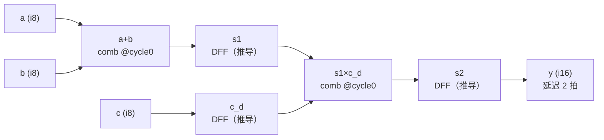

# V6 Cycle-Aware 入门：玩具流水线与 LFSM 真实代码对照

> 教程 · 用一个 ~40 行的两级流水线玩具电路 `y = (a + b) * c` 讲透 V6 周期感知
> （Cycle-Aware）的核心特性，再对照 LFSM 真实代码说明同一纪律的工程应用。
> 所有结论都以**实际编译出的 MLIR 与实际仿真输出**佐证（2026-10-16 运行）。
>
> 权威来源：[docs/v6_PyCircuit_Specification.md](../../../../docs/v6_PyCircuit_Specification.md)（§2/§4/§6/§9）
> 进阶阅读：[V6周期感知_CycleAware设计_LFSM代码体现.md](V6周期感知_CycleAware设计_LFSM代码体现.md)
> 配套代码：[examples/cycle_aware_toy/toy_pipeline.py](../examples/cycle_aware_toy/toy_pipeline.py)
> 配套测试：[test_toy_pipeline.py](../examples/cycle_aware_toy/test_toy_pipeline.py)、
> [test_toy_stall.py](../examples/cycle_aware_toy/test_toy_stall.py)

---

## 1. 一分钟总览：四个核心概念

| 概念 | 一句话 | 规范出处 |
| :--- | :--- | :--- |
| CAS 周期标签 | 每个信号（`CycleAwareSignal`）携带"逻辑周期"；组合不同周期信号时输出取 **max(cycle)**，较早信号自动补 DFF | Spec §1/§6 |
| `domain.next()` | 推进逻辑周期 = 声明一个时序分界点；同一 cycle 内的信号链是**零延迟纯组合** | Spec §6 |
| 寄存器推导 | `domain.signal()` 声明（Q 端 cycle 0 可读）+ `<<=` 在 cycle 1 写 ⟹ 一级 DFF。**寄存器是推导出来的，不是手写的** | Spec §4 |
| `assign(when=)` | 寄存器使能：条件成立的拍末才更新，其余拍保持 —— 反压不需要独立 FSM | Spec §3.4 |

读法收益（也是本教程的主线）：**`domain.next()` 的次数 = 时序分界数；
`<<=` 出现在哪个 cycle = 寄存器插在哪；流水线级数 = 寄存器链深度。**
时序结构可以不动仿真器直接从源码数出来。

---

## 2. 玩具电路：两级流水线 `y = (a + b) * c`

完整代码（[toy_pipeline.py](../examples/cycle_aware_toy/toy_pipeline.py)，
与 LFSM 全部 13 个带状态叶模块同款的**四段式骨架**）：

```python
def toy_pipe(m, domain, *, inputs=None, prefix="toy"):
    # ── Cycle 0: state ──  domain.signal() 声明即读：Q 端 cycle 0 立即可用
    s1  = domain.signal(width=9,  reset_value=0, name=f"{prefix}_s1")
    s2  = domain.signal(width=16, reset_value=0, name=f"{prefix}_s2")
    c_d = domain.signal(width=8,  reset_value=0, name=f"{prefix}_c_d")

    # ── Cycle 0: inputs ── 裸 Wire 必须 cas() 包装并显式标注周期
    a = cas(domain, m.input(f"{prefix}_a", width=8), cycle=0)
    b = cas(domain, m.input(f"{prefix}_b", width=8), cycle=0)
    c = cas(domain, m.input(f"{prefix}_c", width=8), cycle=0)

    # ── Cycle 0: combinational ── 同一 cycle 内 = 零延迟纯组合
    sum_ab = a.zext(9) + b.zext(9)        # stage-1：本拍新值（@cycle 0）
    prod   = s1.zext(16) * c_d.zext(16)   # stage-2：读 s1/c_d 的 Q 端（上拍提交值）
    outs = dict(y=s2, dbg_sum=sum_ab, dbg_s1=s1, dbg_c_d=c_d, dbg_prod=prod)

    domain.next()                         # ← 唯一的时序分界

    # ── Cycle 1: commits ── 读 cycle 0 / 写 cycle 1 ⟹ 各推导一级 DFF
    s1  <<= sum_ab
    c_d <<= c
    s2  <<= prod
    ...
```

对应的硬件（代码结构 ⟹ 电路结构，一一对应）：



三个信号角色：

| 信号 | 角色 | 为什么需要 |
| :--- | :--- | :--- |
| `s1` | stage-1 → stage-2 流水寄存器 | 把"本拍的和"留给"下拍的乘法" |
| `c_d` | 操作数 `c` 的对齐寄存器 | `c` 必须与`上拍`的 `a+b` 配对，故显式打一拍 |
| `s2` | 输出流水寄存器 | 乘法结果再寄一拍，`y` 延迟 = 2 拍 |

> 旁注（宽度纪律）：PyCircuit 算术保持最大操作数宽度（截断），所以
> `zext(9)` / `zext(16)` 是显式扩位——这与 LFSM [types.py](../lfsm/types.py)
> `rg_len_of` / `mulc` 的注释完全一致：宽度增长必须显式。

---

## 3. 特性 1：寄存器推导 —— 代码里没有"寄存器"三个字

`domain.signal()` 在 cycle 0 声明、Q 端立即可读；`domain.next()` 之后 `<<=`
把写动作落在 cycle 1。**读写周期差 1，编译器推导出一级反馈寄存器。**

实际编译（`python3 toy_pipeline.py`）输出的 MLIR —— 每个 `signal()` 恰好一个
`pyc.reg`，D 端用 `__next` 线网 + `pyc.assign` 连接：

```mlir
%v1 = pyc.wire {pyc.name = "toy_s1__next"} : i9
%v4 = pyc.reg %clk, %rst, %v2, %v1, %v3 : i9      ; ← toy_s1 推导出的 DFF
%v5 = pyc.alias %v4 {pyc.name = "toy_s1"} : i9
...
%v18 = pyc.add %v16, %v17 : i9, i9 -> i9          ; ← sum_ab（纯组合）
%v21 = pyc.mul %v19, %v20 : i16, i16 -> i16       ; ← prod  （纯组合）
pyc.assign %v1, %v18 : i9                          ; ← s1 <<= sum_ab（接 D 端）
```

统计输出（实测）：

```
===== toy_pipe:       pyc.reg=3, _v5_bal regs=0 [] =====
===== toy_pipe_stall: pyc.reg=3, _v5_bal regs=0 [] =====
```

规范 §4 的推导规则表：

| 读周期 | 写周期 | 推导结果 |
| :--- | :--- | :--- |
| 0 | 1 | 一级反馈寄存器（DFF）—— 最常见 |
| 0 | 0 | 组合赋值（无寄存器） |
| 0 | N≥2 | N 级流水反馈（罕见，需明确意图） |
| N | < N | **编译错误**：不能向过去赋值 |

### 反例实测：`toy_pipe_bad` —— 规范判错，但 eager 前端静默接受

教程专门构造了"向过去赋值"反例（在 cycle 0 把 cycle-1 信号 `v_d` 写进 `x`）。
**实际运行：前端不报错**，生成的 MLIR 是 `v_d`（一级 DFF）的 Q 再串 `x`
（第二级 DFF）—— 静默变成两拍级联延迟链，语义很可能不是设计意图：

```mlir
%v4 = pyc.reg ... {pyc.name = "toybad_x"}   : i8
%v9 = pyc.reg ... {pyc.name = "toybad_v_d"} : i8
pyc.assign %v6, %toybad_v : i8     ; v_d <= v
pyc.assign %v1, %v10    : i8       ; x   <= v_d.Q（级联，无报错）
```

**教学结论**：cycle 纪律目前主要靠 **authoring 纪律 + 结构测试**守护
（gate-first 精神的注脚），不能把前端当类型检查器用。LFSM 的做法见 §6。

---

## 4. 特性 2：同拍 = 纯组合，跨拍 = 寄存提交

这是 cycle-aware 最日常的一条：**不跨 `domain.next()` 的信号链零延迟穿透；
跨界的值只能经寄存器提交，次拍可见。** 由
[test_toy_pipeline.py](../examples/cycle_aware_toy/test_toy_pipeline.py)
逐拍实证（C++ 周期精确仿真，全部 expect 通过）：

| cycle | 驱动 (a,b,c) | `dbg_sum`（同拍组合） | `s1` Q | `c_d` Q | `dbg_prod`（同拍组合） | `y`=`s2` Q |
| :---: | :---: | :---: | :---: | :---: | :---: | :---: |
| 0 | 3,4,5 | **7**（当拍可见） | 0 | 0 | 0 | 0 |
| 1 | 10,20,2 | 30 | **7**（次拍可见） | 5 | **35**（Q 端当拍穿透） | 0 |
| 2 | – | – | 30 | 2 | 60 | **35**（延迟 2 拍） |
| 3 | – | – | – | – | – | **60**（II=1 连发） |

读表要点：

- cycle 0：drive 的同拍，`dbg_sum=7` 即可观测 —— **同拍 = 纯组合**。
- cycle 1：`s1`/`c_d` 的 Q 端出现上拍数据 —— **跨拍 = 寄存提交，次拍可见**；
  而 `dbg_prod=35` 在同一拍由 Q 端组合算出 —— 组合可以穿透寄存器 Q 端继续走。
- cycle 2→3：第一拍、第二拍的结果依次出管 —— **延迟 = 寄存器链深度（2 拍），
  吞吐 = II 1（每拍一个）**，经典流水特征。

---

## 5. 特性 3：`domain.next()` = 时序分界点

玩具代码只有一处 `domain.next()`（`s1 <<= sum_ab` 之前），它同时是
"stage-1 求值"与"统一提交"的分界。LFSM 把这条做成硬性纪律：**每个带状态
叶模块恰好 1 次 `domain.next()`**（对 `lfsm/` 全目录 grep 可证，13 个模块
逐一列出见 [V6周期感知…代码体现](V6周期感知_CycleAware设计_LFSM代码体现.md) §3）：

| 模块 | `domain.next()` 行 | 模块 | `domain.next()` 行 |
| :--- | :--- | :--- | :--- |
| walker | [143](../lfsm/walker.py#L143) | rd_queue | [103](../lfsm/rd_queue.py#L103) |
| rdgen | [134](../lfsm/rdgen.py#L134) | cand_holder | [106](../lfsm/cand_holder.py#L106) |
| arbiter | [68](../lfsm/arbiter.py#L68) | req_sched | [117](../lfsm/req_sched.py#L117) |

于是读任何一个 LFSM 模块都是同一个节奏：**`next()` 之上是 cycle 0 的世界
（组合 + 次态表达式），之下是 cycle 1 的世界（只有 `<<=` / `.assign()`）。**

---

## 6. 特性 4：自动周期平衡（`_v5_bal`）与 LFSM 的"驯化"纪律

把不同 cycle 的信号组合时，编译器按 **max 规则**自动给较早的信号补 DFF。
变体 `toy_pipe_bal`（`sum_d` 显式打一拍后与 cycle-0 的 `c` 相乘）实测 MLIR：

```mlir
%v7  = pyc.reg ... {pyc.name = "toybal_sum_d"} : i9    ; 显式 domain.cycle()
%v10 = pyc.zext %toybal_c : i8 -> i16
%v14 = pyc.reg ... {pyc.name = "_v5_bal_1"}    : i16   ; ← 编译器自动插入
pyc.assign %v11, %v10 : i16                            ;   c 被补 1 拍
%v16 = pyc.mul %v9, %v15 : i16, i16 -> i16
```

统计（实测）：`toy_pipe_bal: pyc.reg=2, _v5_bal regs=1 ['_v5_bal_1']`。
细节：平衡 DFF 插在被延迟信号**当时的线网**上（本例是 zext 之后的 16 位
线网），宽度即该线网宽度。

**LFSM 的立场：自动平衡仍在，但被纪律驯化为零效应。**
[types.py](../lfsm/types.py) docstring 规定所有表达式在 cycle 0
（`domain.next()` 之前）算完，之后只允许 `<<=` / `.assign()` 引用预算好的
表达式 —— 于是没有任何 `_v5_bal` 被插入，并由结构测试固化
（[test_walker.py:129-133](../tests/unit/test_walker.py#L129)）：

```python
def test_walker_mlir_clean():
    """Structural: compiles, no balancing registers inserted."""
    mlir = compile_cycle_aware(build, name="tb_walker_top", eager=True).emit_mlir()
    assert "func.func" in mlir
    assert "_v5_bal" not in mlir
```

**意义：pipeline 划分是设计决策，不允许编译器"帮忙"改。**
（本教程玩具的三个良好变体同样通过了同型结构断言：
`test_toy_pipe_mlir_clean` / `test_toy_pipe_stall_mlir_clean`。）

---

## 7. 特性 5：`.assign(when=)` —— 条件保持即"反压无状态机"

变体 `toy_pipe_stall` 给流水线加 `stall` 输入，三个寄存器全部改用
`.assign(next, when=run)`（`run = ~stall`）。MLIR 实测显示 `when=` 被
lowering 成 **mux 反馈**——"保持"是显式写在组合逻辑里的：

```mlir
%v22 = pyc.not %toys_stall : i1
%v23 = pyc.mux %v22, %v18, %v5 : i1, i9, i9 -> i9   ; ← s1.assign(sum_ab, when=run)
pyc.assign %v1, %v23 : i9                            ;   = mux(run, next, Q)
```

[test_toy_stall.py](../examples/cycle_aware_toy/test_toy_stall.py) 逐拍实证
（beat0=(3,4,5)，beat1=(9,9,9)；仿真全部 expect 通过）：

| cycle | stall | `s1` Q | `prod`（组合） | `y` | 事件 |
| :---: | :---: | :---: | :---: | :---: | :--- |
| 0 | 0 | 0 | 0 | 0 | 灌 beat0 |
| 1 | 1 | 7 | 35 | 0 | 灌 beat1；stall 拉起 |
| 2 | 1 | **7（保持）** | 35 | **0（冻结）** | `when=` 不成立 ⟹ 不更新 |
| 3 | 1→0 | 7（保持） | 35 | 0（冻结） | 拍末释放 stall |
| 4 | 0 | 18 | 162 | **35（解冻）** | beat0 结果出管 |
| 5 | 0 | – | – | **162** | beat1 结果出管 |

工程对照：LFSM 全部反压/握手保持都用这一招，没有任何独立反压 FSM ——
[req_sched.py:106-108](../lfsm/req_sched.py#L106) 的 `cnt_nxt` 用 `mux`
显式保持（ready=1 时 pop 与 push 同拍、计数不变）；
[config_regs.py:233-238](../lfsm/config_regs.py#L233) 的 `cfg_*.assign(...,
when=start)` 与本玩具同款。审查反压正确性 = 逐寄存器检查 `when` 表达式清单。

---

## 8. 特性 6：CycleAwareTb —— 与设计对称的测试周期模型

测试台用与设计**对称**的周期模型编写：`tb.next()` 推进、`drive/expect` 落在
当前周期，不用手工数绝对拍号。观测相位精确到"沿前/沿后"：

| phase | 含义 | 用途 |
| :--- | :--- | :--- |
| `"pre"`（TICK-OBS） | 时钟沿计算后、提交前观测 | 看本拍组合值 / 本拍寄存器 Q 端 |
| `"post"`（XFER-OBS） | 提交后观测 | 看刚提交的新状态 |

玩具 TB 里的一次实证（[test_toy_pipeline.py](../examples/cycle_aware_toy/test_toy_pipeline.py)）：

```python
tb.expect("toy_dbg_prod", 35, phase="pre",  msg="c1 同拍组合 prod")
tb.expect("toy_y",        35, phase="post", msg="c1 post == c2 pre")
```

**cycle 1 的 post 观测 == cycle 2 的 pre 观测**（提交把状态推进了一拍）——
两个相位在同一个仿真里对上同一个物理值，这是对"cycle 0 组合 / cycle 1
提交"设计相位的镜像确认。LFSM 的 walker 单测全部用 `phase="pre"` 逐拍比对
token 流（[test_walker.py:68-83](../tests/unit/test_walker.py#L68)），口径一致。

---

## 9. 对照真实代码：LFSM 把同一纪律用到工程规模

### 9.1 walker —— 四段式骨架（[walker.py](../lfsm/walker.py)）

| 段 | 行号 | 内容 |
| :--- | :--- | :--- |
| Cycle 0: state | [54-60](../lfsm/walker.py#L54) | 7 个 `domain.signal()` 声明 |
| Cycle 0: inputs | [63-70](../lfsm/walker.py#L63) | `sin()` 双模输入 |
| Cycle 0: combinational | [73-110](../lfsm/walker.py#L73) | 转移优先级、token 输出 |
| Cycle 0: next-state | [114-141](../lfsm/walker.py#L114) | 次态表达式 |
| `domain.next()` | [143](../lfsm/walker.py#L143) | 唯一时序分界 |
| Cycle 1: commits | [146-152](../lfsm/walker.py#L146) | 统一 `<<=` |

与玩具 `toy_pipe` 的差别只有规模 —— 骨架一字不差。

### 9.2 req_sched —— grant 拍 / issue 拍分离（[req_sched.py](../lfsm/req_sched.py)）

2-slot 发送队列，`pop`（issue）与 `push`（grant 反压闭环）都是 cycle-0
当拍电平（[req_sched.py:67-70](../lfsm/req_sched.py#L67)）：

```python
front_valid = cnt > u(2, 0)
pop = front_valid & mem_ready            # issue 拍：当拍出队（同拍组合）
room = (cnt < u(2, 2)) | ((cnt > u(2, 0)) & mem_ready)
push = push_valid & room                 # grant 拍：cnt=2 冻结 push（反压）
...
outs = dict(..., o_mem_req_valid=pop, ...)   # 同拍组合直接出端口
```

`o_mem_req_valid = pop` 是玩具里 `dbg_sum` 同型：同拍组合穿透到输出。

### 9.3 三条数据通路边的 bypass 契约 = 周期语义

| 边 | 契约 | 周期表达 |
| :--- | :--- | :--- |
| queue → assembler | **禁止**同拍 bypass | 入队 cycle 1 `<<=`，次拍可见（玩具 `s1` 同型） |
| assembler → cand_holder | 允许同拍 bypass | cycle-0 组合链直接消费（玩具 `dbg_sum` 同型） |
| cand_holder → arbiter | 严格流水（GAP-06） | outs 只含 held 寄存器 Q 端，零 fresh 旁路（玩具 `y=s2` 同型） |

详细论证见 [V6周期感知…代码体现](V6周期感知_CycleAware设计_LFSM代码体现.md) §5-§8。

---

## 10. 一屏速查表（代码结构 → 硬件）

| 代码结构 | 硬件 | 玩具实证 | LFSM 同型 |
| :--- | :--- | :--- | :--- |
| `domain.signal()` + `next()` + `<<=` | 一级 DFF（读0写1推导） | 3 个 `pyc.reg` | 13 个叶模块同款 |
| 同一 cycle 内的表达式链 | 纯组合（零延迟穿透） | `dbg_sum` 当拍可见 | assembler `view_*`、`pop` |
| 寄存器 Q 端参与的组合 | 次拍组合（跨拍=寄存提交） | `dbg_prod`=35 @c1 | token 输出、`o_mem_req_valid` |
| 显式 `domain.cycle()` | 一级 DFF（打拍） | `toybal_sum_d` | –（LFSM 不用） |
| 混周期组合（max 规则） | 自动补 `_v5_bal` DFF | `_v5_bal_1`（16 位） | 纪律性零插入 + 结构断言 |
| `.assign(x, when=cond)` | 寄存器使能 = `mux(cond, x, Q)` | stall 冻结 2 拍 | `cnt_nxt`、`cfg_*` |
| `domain.next()` 计数 | 时序分界点数 | 1 次 | 每模块恰好 1 次 |
| 寄存器链深度 | 流水线延迟拍数 | s1→s2 = 2 拍 | GAP-06/07 链首 +2 拍 |
| TB `phase="pre"/"post"` | 沿前/沿后观测 | c1 post == c2 pre | walker 单测全 pre |

---

## 11. 复现命令

```bash
# 发射四个变体的 MLIR（含 pyc.reg / _v5_bal 统计与 bad 反例真实行为）
python3 designs/LFSM/pycircuit/examples/cycle_aware_toy/toy_pipeline.py

# 跑周期精确仿真（C++ build + 逐拍 expect）
python3 designs/LFSM/pycircuit/examples/cycle_aware_toy/test_toy_pipeline.py
python3 designs/LFSM/pycircuit/examples/cycle_aware_toy/test_toy_stall.py
```

2026-10-16 实测：三个结构断言（reg 计数 / 零 `_v5_bal` / bal 恰好 1 个平衡
寄存器）全部通过；两个 TB 全部 `OK`。

---

## 12. 相关文档索引

| 材料 | 位置 |
| :--- | :--- |
| 周期感知语言定义 | [docs/v6_PyCircuit_Specification.md](../../../../docs/v6_PyCircuit_Specification.md) §2/§4/§6/§9 |
| Cycle-Aware 在 LFSM 的逐条体现（进阶） | [V6周期感知_CycleAware设计_LFSM代码体现.md](V6周期感知_CycleAware设计_LFSM代码体现.md) |
| 可读性三维度收益 | [V6代码可读性_代码理解_调试成本_LFSM实例.md](V6代码可读性_代码理解_调试成本_LFSM实例.md) |
| 手写 RTL vs V6 对比 | [V6可读性对比_FSM跳转_手写RTL_mkn_walker_vs_V6_walker.md](V6可读性对比_FSM跳转_手写RTL_mkn_walker_vs_V6_walker.md) |
| 逐拍伪码（Step 6 定稿） | [ALGORITHM_CYCLE_AWARE_PSEUDOCODE.md](../docs/ALGORITHM_CYCLE_AWARE_PSEUDOCODE.md) |
