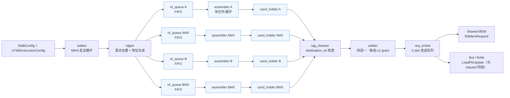
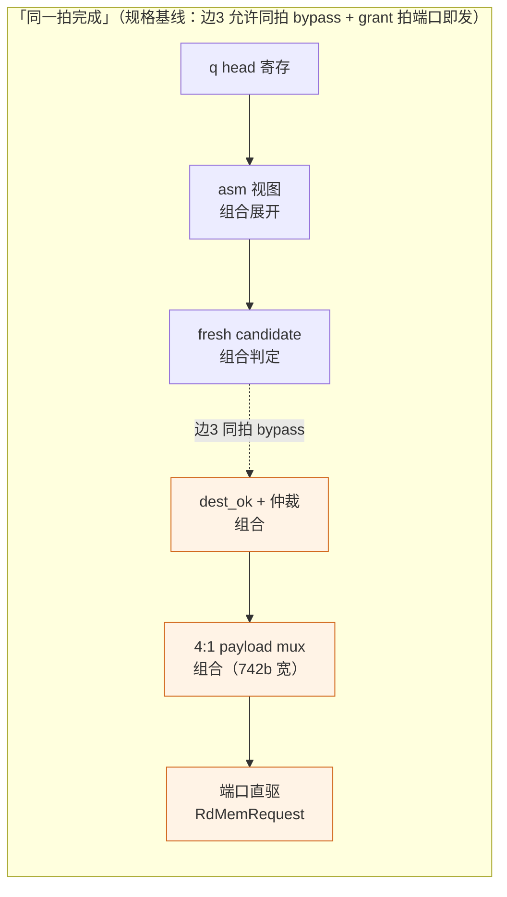
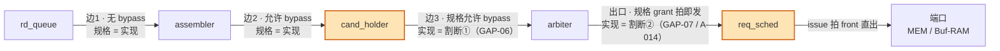
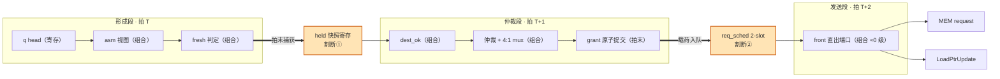

# Pipeline 划分修改工作记录与下一步方向评估

> 汇报材料 · LFSM（4EU UU mode）PyCircuit V6 设计
> 事项：流水线（时序分段）划分的两次迭代修改——**边3 严格流水**（GAP-06）与
> **发送段 req_sched**（GAP-07 / A-014），及基于既有逻辑深度估算的下一步方向评估
> 权威来源：`docs/ALGORITHM_PIPELINED.md` §1/§3/§4/§8.1、`ASSUMPTIONS.md` A-006 v2/A-014、
> `TRACEABILITY.md` GAP-06/GAP-07
> 整理日期：2026-10-15；状态：两项决策已 frozen 进 Step 5/6 文档，Step 9 实现进行中
> **读者预设：无本项目背景资料**——§2 为背景介绍（Mermaid 图示 + 逐拍伪代码）；
> 系统层概念（LFSM/owner/L0B/MEM 布局）见同目录《L0B_layout输入规格修改工作记录》§2。

---

## 1. 事项概述

| 项 | 内容 |
| :--- | :--- |
| 修改对象 | LFSM candidate→fire→MEM 下发的**时序分段**（pipeline 划分） |
| 规格基线 | SRC-01（`02_LFSM.md`）：边3「Packer→Arbiter **允许**同拍 bypass」（sec 5）+「`rd_mem_fire` grant 拍端口即发」单拍原子提交（sec 13） |
| 修改结论 | 单拍组合链拆为**三拍分段**：形成段 → 仲裁段 → 发送段；两处均为登记的**规格偏差**（GAP-06 / GAP-07） |
| 决策日期 | 2026-10-14（两个用户决策同日落地） |
| 决策编号 | 边3 严格流水（GAP-06，ASSUMPTIONS 预登记 A-013）；发送段 req_sched（A-014，**推翻 A-006 v1**，GAP-07） |
| 功能影响 | 语义零变化；golden 对拍口径改为「逐笔 fire 元数据等价 + 链首相移合计 **+2 拍**」；连发节奏保持 1 grant/拍、1 issue/拍 |

---

## 2. 背景介绍（零基础读者向）

### 2.1 这条数据通路在做什么（工作流全图）

LFSM 按 MKN 循环为 A/B 操作数生成读请求，凑成 128B 满宽的 candidate 后
四选一仲裁，发给 Shared MEM，并同步通知 Buf/RAM 推进写指针：



- **candidate**：某条 lane 凑满 128B 带宽的一笔"待发包裹"（源地址、目的
  tag、字节账目等元数据）；
- 四条 lane 各自缓存 candidate，**arbiter 每拍最多放行 1 笔**——这是全
  通路的吞吐瓶颈点，也是 pipeline 划分最敏感的位置。

### 2.2 关键概念速览

| 术语 | 含义 | 类比 |
| :--- | :--- | :--- |
| 拍（cycle） | 一个时钟周期，数字电路的最小时间格 | 传送带每次前进一格 |
| 组合逻辑 | 输入到输出**当拍**算出结果的电路（无记忆） | 一棒接一棒的接力跑 |
| 寄存器 | 拍末锁存、次拍输出的存储单元 | 接力跑的**交接棒点** |
| **同拍 bypass（旁路）** | 本拍新产生的数据**当拍**被下游直接使用（组合穿透） | 不等交接点，直接递过去 |
| **寄存割断** | 在链路中间插寄存器，数据**晚一拍**再到下游 | 强制在交接点歇一脚 |
| **逻辑级数** | 一段组合链的深度（门级数）；一拍能跑完的级数有限，超了主频就得降 | 一棒人能跑的距离有上限 |
| candidate / held 快照 | cand_holder 里寄存的"候车 candidate"，每 lane 恰好 1 个 | 候车室，每 lane 一个座位 |
| grant / fire | 仲裁获胜并原子提交（消费、binding、指针推进同拍生效） | 放行 + 盖章 |
| grant 拍 / issue 拍 | grant 拍 = 仲裁提交拍；issue 拍 = 请求真正出现在端口的拍 | 盖章日 / 寄出日 |
| req_sched | 2-slot 发送队列，grant 拍装载、issue 拍发出 | 寄出前的收发室（两个格子） |
| LoadPtrUpdate | 随 request 同组发给 Buf/RAM 的写指针推进通知 | 包裹单上附带的入库指令 |
| 规格偏差（GAP） | 实现与规格原文不一致、但经决策并登记的条目 | 有签字的"特许通行证" |

### 2.3 规格基线：一条挤在同一拍的长链

一拍的时间是有限的：组合链**级数**超过一拍能跑完的上限，全芯片主频就
得为它降速。规格基线允许从 queue head 到端口几乎全部环节压在一拍内：



一棒之内要跑完：asm 块展开 + **跨模块** tag 查询（query 出模块、Buf/RAM
算 idle、再回来）+ 仲裁比较树 + 742b 宽 mux + 端口驱动——这正是时序
压力的来源。

### 2.4 修改后：两道寄存割断，一棒拆三棒

链路三条边的规格契约与本次两处割断的位置：



三拍分段的数据流（一笔 candidate 的旅程）：



逐拍行为伪代码（对应 Step 5/6 文档的 cycle-0 组合 / cycle-1 提交语义；
`<=` 表示拍末寄存）：

```python
# ── 形成段：拍 T（组合求值 → 拍末捕获）──
view    = asm_expand(q_head, ctx)              # 组合：queue head 展开为块视图
fresh   = formable(view)                       # 组合：满宽/齐套判定
held   <= snapshot(view) if fresh else repl    # cycle-1：held 快照捕获【割断①】

# ── 仲裁段：拍 T+1（只读 held 的 Q 端，不碰 fresh）──
dest_ok = tag_check(held, i_load_range_idle)   # 组合：跨模块 tag 查询环（R1）
grant   = arbitrate(held_valid, dest_ok,       # 组合：优先键 + RR，每拍 ≤1
                    issue_room, rr_cursor)
commit(grant)                                  # cycle-1：consume/binding/
                                               #   load_ptr/RR cursor 原子提交
req_sched <= mux_11A(views, grant)             # cycle-1：载荷入发送队列【割断②】

# ── 发送段：拍 T+2（front 寄存直出，组合 ≈0 级）──
o_mem_req = req_sched.front                    # request + LoadPtrUpdate 同组原子
pop when req_sched.front and i_shared_mem_ready
```

关键不变量：**仲裁段的全部数据/键类输入只认 held 的 Q 端**（fresh 形成拍
仅供捕获，不旁路）——这是割断①的正式定义。

连发流水视图（稳态每拍 1 grant + 1 issue，仅首笔晚 2 拍）：

| 拍 | 形成段 | 仲裁段 | 发送段 |
| :--- | :--- | :--- | :--- |
| T | cand 0 | — | — |
| T+1 | cand 1 | cand 0（grant） | — |
| T+2 | cand 2 | cand 1（grant） | cand 0（issue） |
| T+3 | cand 3 | cand 2（grant） | cand 1（issue） |
| T+4 | … | cand 3（grant） | cand 2（issue） |

代价与收益小结：**首笔延迟 +2 拍**；每段组合级数降到估算 15–25 级
（§5），端口变为纯寄存出口；稳态吞吐不变。

---

## 3. 迭代演进时间线

| 日期 | 事件 |
| :--- | :--- |
| 2026-09-24 | **RTL 先行**：DOC_SYNC_QUEUE 条目 `lfsm_req_payload_pipe`——RTL 把 `RdMemRequest` payload 通道从 sec 13 原子提交中剥离，`lfsm_req_pipe` 寄存晚一拍送出，arbiter 改纯控制（动机：4×742b payload mux 不压 fire 路径，P4 组合深度预算）；V6 侧当时列为 pending 候选 |
| 2026-10-13 | Step 5 初稿 **A-006 v1：不采纳** payload 晚一拍——判断属 RTL 组合深度优化，本轮保持 sec 13 单拍原子提交语义 |
| 2026-10-14 | **用户决策 ①边3 严格流水**（GAP-06）：仲裁输入束只认 held 快照寄存，fresh candidate 形成拍不 fire，链首 +1 拍 |
| 2026-10-14 | **用户决策 ②A-014 发送段 req_sched**（GAP-07，推翻 A-006 v1）：§11A mux 载荷（request + LoadPtrUpdate 同组）经 2-slot 发送队列在 issue 拍（grant 次拍）原子发出 |
| 2026-10-14 | 同日配套：arbiter **纯控制化**（payload 4:1 mux 剥离至顶层 §11A 组合云）；改名 `packer→cand_holder`、`allocator→tag_checker`（语义/接口不变） |

要点：A-014 与 RTL 2026-09-24 候选**方向一致**，V6 采纳时补全了三件事——
LoadPtrUpdate 同组、2-slot 深度（保 ready=1 稳态 1 issue/拍）、`issue_room`
反压闭环回仲裁侧。

---

## 4. 修改后 Pipeline 划分（三拍分段，契约级描述）

```text
形成段（本拍 cycle-0 组合 + cycle-1 捕获）：
    q head(寄存) → asm 视图(组合) → fresh 判定(组合) → held 快照捕获(拍末)
仲裁段（次拍 cycle-0 组合）：
    held Q → tck dest_ok(组合) → arb grant(组合) → §11A 顶层 mux(组合)
    → grant commit（consume/binding/load_ptr/RR，拍末原子）
    + §11A 载荷（含 LoadPtrUpdate 组）push 入 req_sched（拍末捕获）
发送段（再次拍 cycle-0 组合）：
    req_sched front(寄存) → o_mem_req_* / o_load_ptr_update_*
    （同拍原子发出；o_mem_req_valid = front && i_shared_mem_ready）
```

两道**寄存割断屏障**：held 快照寄存器（边3）+ req_sched 2-slot 队列（发送段），
均为状态、无组合越段。

### 4.1 边3 严格流水（GAP-06 偏差要点）

- 仲裁输入束**只认 held 快照（Q 端）**，数据/键类全部同源；fresh candidate
  形成拍仅供拍末 held 捕获，**次拍起**参与 dest_ok 与仲裁；
- `source_ok` / `i_register_ready` / `i_load_range_idle` 保持当拍电平采样
  （eligibility 每拍重算，R-34）；
- held 快照一致性不变量（sva）：held valid ⇒ asm 视图 == held 内容
  （context 至 fire 前不推进，F-113）；
- replacement 链维持每拍 1 grant——**吞吐不降**，仅链首 +1 拍。

### 4.2 发送段 req_sched（GAP-07 / A-014 偏差要点）

- grant 与 MEM 下发解耦：内部 grant commit（consume/binding/load_ptr/
  group/RR）**仍在 grant 拍原子**；端口「update+request 同拍」原子关系
  **原样保留**（sec 13/14.1 端口口径不变），只是落位 issue 拍；
- `i_shared_mem_ready` 落位队列出口（issue 拍当拍电平采样），eligibility
  改用 `issue_room`（队列 cnt=2 时冻结 grant，反压闭环）；
- `o_lfsm_idle` 聚合增含 `rqp_empty`；
- 端口变为**纯寄存出口**，彻底解除端口 deadline 压力。

### 4.3 反压表现（无独立反压状态机）

`dest_ok=0`/`source_ok=0` → eligibility=0；`mem_ready=0` → 队列 front 保持不
pop、cnt 到 2 → `issue_room=0` 冻结 grant；`register_ready=0` 关断 C issue。
任一情形当拍无 `fire_consume` → 全部状态经 `assign(when=)` 条件保持。

---

## 5. 已有估算（Step 5 §4/§8.1 定稿值）

### 5.1 逻辑深度估算（门级量级粗估，ASIC 口径）

| 环 | 路径 | 主要逻辑 | 量级 | 评价 |
| :--- | :--- | :--- | :--- | :--- |
| 形成段 | `q head/head1` 寄存 → chd 捕获写端 | head/head1 读出（B 128:1 ×2 口）→ asm view 标量 → 捕获使能 | ≈10–15 级 | 非 fire 环，只需拍末前稳定，**非全局关键** |
| 仲裁段·**决策环 R1** | `held Q/ctx` → grant（§11B 入队使能） | tck planned mux → **`o_load_range_query` 出模块 → 外部 Buf/RAM 组合算 idle** → dest_ok → 4 路 18b argmin（6–8）→ RR（3–4）→ grant | 内部 ≈15–20 级 **+ 外部未知** | **头号风险**：A-004 跨模块同拍组合查询环，规格强制不可内部切分 |
| 仲裁段·**数据环 R2** | `ctx/held` 寄存 → §11B 队列写端 | asm 元数据视图重组算：**BMX 32-slot mem-pad 地址 + ≤32 writes dest_base 加法**（AMX ≈16 fragment 同类，B/A 浅）→ §11A 4:1 宽 mux → 队列写端 | ≈15–25 级 | **BMX 最深**；A-014 后终点为队列写端而非端口（输出 pad 移出数据环） |
| 发送段 | `req_sched` 寄存 → 端口 | front 直出 | ≈0–2 级 | **A-014 收益**：纯寄存出口 |
| 面积项 R4/R5 | — | §11A 4:1×（32b×32 src + 27b×32 wr）宽 mux；B 128 深双读口 | 深度小 | 面积/布线成本，非深度 |

### 5.2 寄存器量级估算（信息量，供 Step 9 核对）

cfg ≈150b；walker ≈45b；rdgen 48b；四路 RD Queue ≈**8.3Kb**
（A 16×55 + AMX 8×62 + B 128×56 + BMX 4×75）；assembler context ≈**2.8Kb**
（A 55b + B 140b + AMX 400b + BMX 2×(32×32+40)）；held ≈4×46b；tck ≈4×24b；
**req_sched ≈2×2.3Kb**（A-014 新增，占总量可观比例）；C FIFO ≈8×60b。
合计 ≈16Kb 量级，全部为小并行寄存器组（数据通路只存 metadata，无大容量
单端口结构）。

### 5.3 时序性质小结（修改的收益）

- 相对规格单拍链：最深环从「asm 视图 + 仲裁 + payload mux + 端口直驱」
  一段变为三段，端口段 ≈0–2 级；
- 代价：链首 +2 拍相移（形成→grant→issue），稳态吞吐不变；
- golden 对拍口径随改：逐笔 fire/issue 元数据等价 + 相移
  （TEST_PLAN §0.4 / T-066 / T-070 已随更新）。

---

## 6. 风险处置现状

| 风险 | 处置 | 状态 |
| :--- | :--- | :--- |
| **R1 决策环**（跨模块同拍环，不可内部切分） | 不打拍、**改约束**：对 Buf/RAM 实现方追加集成时序预算（`range_idle` ≤32 tag 预归约/浅逻辑、`fresh_idle_guard` 寄存查看表）；Step 10 sign-off 时序表列「query→idle→grant→fire」为关键路径行；集成 TB stub 深度与预算对齐 | 已定，Step 10 落实 |
| **R2 数据环**（BMX 最深） | A-014 已把终点从端口改为队列写端（缓解一轮）；P1/P1-lite 快照选项**降级为可选**，待 Step 9 时序评估触发 | 观察中 |
| R3 自动周期平衡 | Step 9 审计发射 MLIR 无意外 `pyc.reg` 延迟链 | sign-off 检查项 |
| R4/R5 面积 | §11A 宽 mux + B 128 双读口为保留成本（A-006 v1 曾拒、v2 后属既定） | 接受 |

---

## 7. 下一步可能继续修改的方向（基于已有估算的评估）

### 方向 1：P1 / P1-lite「fire 前付运快照」——应对 R2 数据环（最可能的下一步）

- **触发条件**：Step 9 时序评估显示「数据环 ≈15–25 级 → req_sched 队列
  写端」仍超标。
- **P1（全量快照）**：fresh/repl 捕获拍把该 candidate 的全部付运字段
  （src ranges、writes、三账目、flags）连同当拍 `dest_base` 写入 per-lane
  fire-side 快照寄存（≈2.2Kb×4 ≈ **8.8Kb**）→ 数据环整体移出 grant 路径，
  §11A mux 源改快照寄存。
- **P1-lite（部分快照）**：只快照最重数组字段（BMX/AMX 的 src/wr），
  标量保持组合（≈**4–5Kb**）。
- **评估**：R2 深度集中于 BMX 32-slot 重算 + 宽 mux，P1-lite 以约一半的
  寄存器代价直击最重项，**性价比高于 P1**；且寄存器总量从 ≈16Kb 增至
  ≈21–25Kb（+30~55%），P1-lite 落在低段。建议优先评估 P1-lite。
- **落点（若采纳）**：CYCLE §5–§8（asm 增 fire_copy 寄存组 + capture 使能）、
  §9（chd 输出 capture 使能）、§13（§11A mux 源改 fire_copy）；SEQ §14.3 补
  「付运快照与组合视图在 held 期间逐拍同值」等价性条款；登记 **D-007** 并
  同步 TRACEABILITY（新 GAP 或并入 GAP-06 备注）。**R1 不受 P1 影响**，
  sign-off 时序表仍须两环分开评估。

### 方向 2：R1 决策环的集成侧收敛（不改 LFSM 内部）

- 决策环内部 ≈15–20 级可控，**不确定性全在外部** Buf/RAM 的
  `query→idle` 组合深度。
- 下一步动作是**约束落地**而非设计修改：集成时序预算写进 Buf/RAM 侧
  交付要求、TB stub 按预算实现、Step 10 时序表单列。
- 若外部 idle 实现无法满足预算：只能回 Step 5 重议 A-004 相位契约
  （如 query 提前一拍/idle 寄存化），**属规格契约变更，走 gate-first
  流程**，且会重新引入链首相移——估算层面这是最后的手段。

### 方向 3：B 128 深队列双读口的结构性优化（与 A-002 深度调参联动）

- 形成段的已知代价：head/head1 两路 128:1 寄存器 mux。
- 联动因素：A-002/GAP-02 waiver 显示 worst-legal 形状 B 在途实测 513，
  覆盖全合法形状需把 B 深度参数调到 1024——**若真调深，双读口 mux 将
  从 128:1 变 1024:1，形成段 10–15 级的估算不再成立**。
- 可能方向：队列分 bank/分段（按 head 指针高位预选择）、head/head1
  指针旁路小缓存（head 弹出时才 refill 的 2-entry 前缀寄存器组）。
- 评估：TYPICAL 包络内 128 深度不变则**无需动作**；仅当 waiver 收口
  要求扩大默认深度时启动，属参数复查而非本轮修改。

### 方向 4：面积/布线项（R4/R5）的跟随性优化

- §11A 4:1×（32b×32 src + 27b×32 wr）宽 mux 是 A-014 后保留的面积成本；
  P1-lite 若采纳会顺带缩小该 mux 的组合扇出（源改快照寄存）。
- B 128 深双读口的布线压力同方向 3。**不单独立项**，随方向 1/3 联动解决。

### 不建议的方向（明确排除）

- **重新引入边3 同拍 bypass / 撤销 req_sched**：回退须按 GAP-06/GAP-07
  全文撤销条款执行（PIPE/CYCLE/SEQ/TEST_PLAN 五处同步），无技术收益；
- **backend-only 时序修补**：违反仓库纪律（AGENTS.md gate-first）；
  时序不达标一律回 Step 5 重议划分，不在发射层打补丁。

### 决策触发点汇总

| 方向 | 触发点 | 决策时机 |
| :--- | :--- | :--- |
| P1-lite / P1 | Step 9 `pycircuit build` 后时序评估（数据环→队列写端超标） | Step 9 内 |
| R1 集成预算 | Step 10 sign-off 时序表（R1/R2 分行） | Step 10 |
| B 队列调参/bank | GAP-02 waiver 收口要求扩大默认深度 | sign-off 前评审 |

---

## 8. 相关文档索引

| 材料 | 位置 |
| :--- | :--- |
| Pipeline 划分定稿 + 估算 | `designs/LFSM/pycircuit/docs/ALGORITHM_PIPELINED.md` §1/§3/§4/§8.1 |
| 决策登记 | `docs/ASSUMPTIONS.md` A-006 v2 / A-014；决策一览表「边3 严格流水 / 发送段 req_sched」 |
| 偏差登记 | `docs/TRACEABILITY.md` GAP-06 / GAP-07（含回退条款） |
| 逐拍伪码落点 | `docs/ALGORITHM_CYCLE_AWARE_PSEUDOCODE.md` §9（chd held）/§11A/§11B/§13 |
| 对拍口径 | `docs/TEST_PLAN.md` §0.2/§0.4、T-053/T-066/T-070 |
| RTL 侧先行候选 | `designs/LFSM/design_spec/code/DOC_SYNC_QUEUE.md` `20260924_174700_lfsm_req_payload_pipe_candidate` |
| 同目录汇报材料 | `report/A-001_首访去重替代CAM_设计决策说明.md`；`report/L0B_layout输入规格修改工作记录.md` |
