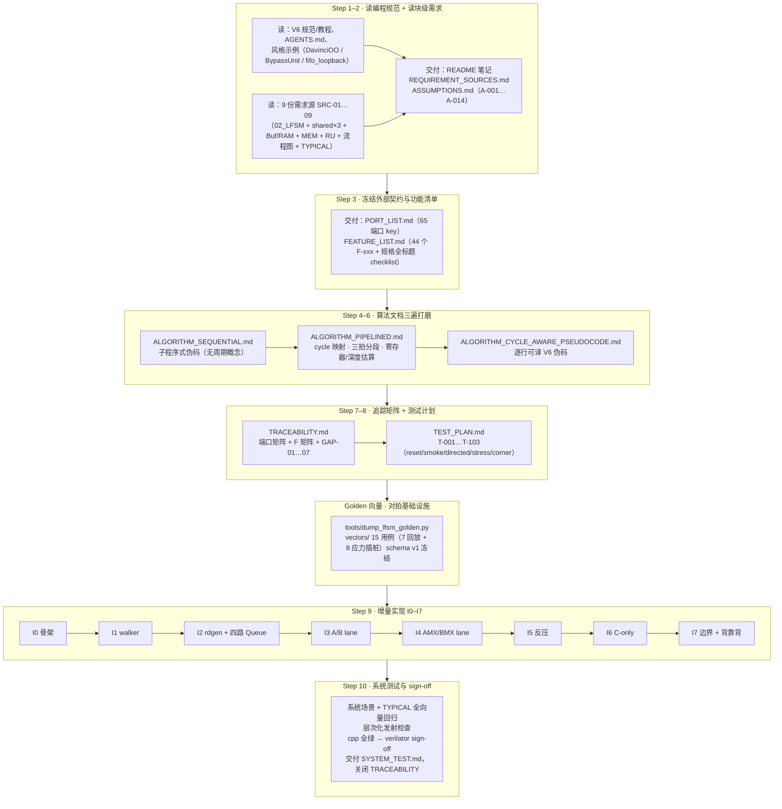
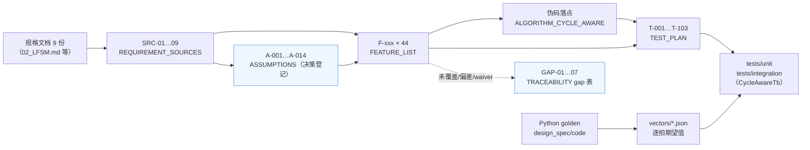

# PyCircuit 十步工作流 · LFSM 设计实例（流程图总结）

> 汇报材料 · LFSM（4EU UU mode）PyCircuit V6 设计
> 事项：以 LFSM 设计为实例，用流程图总结 PyCircuit V6 的**十步实现工作流**——
> 每一步的输入、活动、交付物与关键决策
> 方法论权威来源：`docs/pycircuit_implementation_method.md`
> 执行计划：`.cursor/plans/lfsm_uu_v6_设计实现_d9a4c45e.plan.md`
> 整理日期：2026-10-15

---

## 1. 一句话概述

十步工作流是把一个硬件模块从**规格文档**变成**签核 RTL** 的标准流水线：
**读规范 → 读需求 → 冻结契约 → 写算法（三遍）→ 建追踪 → 定测试 →
增量实现 → 系统签核**。LFSM 的全部工作都按此推进，每一步都有落盘的
交付物（`designs/LFSM/pycircuit/docs/`）。

---

## 2. 十步总览流程图（LFSM 实例）

---

## 3. 逐步明细（输入 → 活动 → 交付物 → 关键事件）

| 步骤 | 目标 | LFSM 输入 | LFSM 交付物 | 关键决策/事件 |
| :--- | :--- | :--- | :--- | :--- |
| **1** 读编程规范 | 内化 V6 表达硬件的方式 | `v6_PyCircuit_Specification/Tutorial/Software_Architecture`、`AGENTS.md`、`docs/updatePLAN.md` | `README.md` 笔记：cycle-aware 为 authoring 模式；风格参考 = DavinciOO（层次化）/ BypassUnit（向量 lane）/ fifo_loopback（FIFO） | 纪律：gate-first、无 backend-only 修补 |
| **2** 读块级需求 | 装载全部规范性输入 | 9 份需求源（02_LFSM、00_TOP、01_FSM走法、02_配置契约、04_Buf_RAM、05_MEM、07_RU、11_流程图、TYPICAL_CASES） | `REQUIREMENT_SOURCES.md`；`ASSUMPTIONS.md`（A-001…A-014） | **A-001 首访去重计数器化**；A-002 队列深度；A-005 v3 loop 几何 walker 现场生成 |
| **3** 端口与功能清单 | 冻结外部契约、拆分可测功能 | 需求源 + A-xxx | `PORT_LIST.md`（65 端口 key、相位契约）；`FEATURE_LIST.md`（44 个 F-xxx + 02_LFSM 全标题 checklist） | A-004 `o_load_range_query` 新增输出（规格只命名了输入） |
| **4** 顺序算法 | 子程序式行为描述，不定硬件边界 | F-xxx + golden 参考模型 | `ALGORITHM_SEQUENTIAL.md`（walker/rdgen/asm/packer/alloc/arb/c_path 伪码 + §14 等价性论证） | D-001 块池=0（emit-on-demand）；fv_a/b/c 注解进 WalkToken |
| **5** 流水线映射 | 把算法对齐到时钟周期 | SEQ + PORT_LIST | `ALGORITHM_PIPELINED.md`（cycle-0 组合/cycle-1 提交、`domain.call()` 链、寄存器推断、存储选型、§8.1 深度估算） | **2026-10-14 边3 严格流水（GAP-06）+ A-014 发送段 req_sched（GAP-07）**——详见同目录 pipeline 文档 |
| **6** 逐拍伪码 | 逐行可译 V6 的完整伪码 | PIPE | `ALGORITHM_CYCLE_AWARE_PSEUDOCODE.md`（每子模块 inputs/outs 键 + `domain.next()` 数 + §11A/§11B） | 每带状态叶模块恰好 1 次内部 `domain.next()` |
| **7** 追踪检查 | 证明覆盖：端口/功能 ↔ 伪码 ↔ 测试 | PORT_LIST + F-xxx + CPS | `TRACEABILITY.md`（端口矩阵 + F 矩阵 + gap 表 GAP-01…07） | GAP-06/07 为已登记规格偏差 |
| **8** 测试计划 | 无端口、无功能未测 | TRACEABILITY | `TEST_PLAN.md`（T-001…T-103；reset/smoke/directed/stress/corner 分类；全部映射 CycleAwareTb） | 对拍口径随 GAP-06/07 改「逐笔等价 + 链首相移 +2 拍」 |
| **+golden** 对拍基础设施 | 让 Python golden 产出逐拍期望值 | `design_spec/code/run_model.py`（4EU non-RU）+ TYPICAL_CASES | `tools/dump_lfsm_golden.py`；`vectors/` 15 用例（7 全量回放 + 8 占用插桩应力），schema v1 冻结 | 15/15 PASS；A-002 插桩实测（B 在途 46 等）全部落账 |
| **9** 增量实现 | 骨架→单功能→测试→重复 | 三份算法文档 + vectors + TEST_PLAN | `lfsm/` 模块代码 + `tests/unit` + `tests/integration` + `IMPLEMENTATION_LOG.md` | 每个增量跑全量回归 + `pycircuit build --target cpp` |
| **10** 系统签核 | 组合流量下验证整体 | 全绿回归 + 系统场景 | `SYSTEM_TEST.md`；层次化发射（`hierarchical=True`）检查；cpp 全绿后 verilator sign-off；关闭 TRACEABILITY | sign-off 时序表 R1/R2 分行评估 |

---

## 4. 证据链视图（交付物之间如何互相引用）

十步流程的核心价值是**可审计的证据链**：任何一行实现都能反查到规格标题，
任何一条规格都有测试兜底。LFSM 实例的引用关系：

- **正向**：规格 → SRC → F-xxx → 伪码落点 → T-xxx → TB 代码；
- **侧挂**：A-xxx 记录"为什么这么设计"（如 A-001 去重、A-014 发送段），
  GAP 表记录"哪里有意的偏差/未覆盖"（如 GAP-06/07 规格偏差、
  GAP-02 worst-legal waiver）——**不允许静默省略**；
- **对拍**：golden 模型 dump 逐拍向量，集成 TB 回放比对，把"等价性"
  从论证变成逐拍证据。

---

## 5. Step 9 增量依赖图

每个增量实现一个功能切片，跑全量回归保持绿色，再开下一个：

- I3/I4 之前 MEM 恒 ready、tag 恒 idle（先通数据通路）；
- I5 起引入反压不变量（hold、优先级）；
- 每步命令：`pycircuit build --target cpp` + 全量单测/回放对拍；
- 记录：`docs/IMPLEMENTATION_LOG.md`（日期、F-xxx、文件、命令）。

---

## 6. 流程治理要点（贯穿十步的纪律）

| 纪律 | 内容 | LFSM 实例 |
| :--- | :--- | :--- |
| gate-first | 语义改动先加/改 MLIR verifier/pass，不做 backend-only 修补 | 时序不达标回 Step 5 重议划分（见 pipeline 文档 §7「不建议的方向」） |
| 规格演进走队列 | candidate（先改代码）→ 用户授权 → freeze & sync docs | L0B layout 修改（`DOC_SYNC_QUEUE` → 2026-10-14 freeze） |
| 对拍闭环 | golden 逐拍向量回放，等价性靠证据不靠论证 | A-001 计数器条件、GAP-06/07 相移口径 |
| 不静默省略 | 未覆盖/偏差/waiver 全部登记 GAP 表 | GAP-01（A 块序 waiver）/ GAP-02（worst-legal 深度 waiver）等 7 条 |
| 小步增量 | 每增量全量回归 + cpp build 绿色 | I0–I7 依赖链（§5） |

---

## 7. 相关文档索引

| 材料 | 位置 |
| :--- | :--- |
| 方法论权威定义 | `docs/pycircuit_implementation_method.md` |
| LFSM 执行计划 | `.cursor/plans/lfsm_uu_v6_设计实现_d9a4c45e.plan.md` |
| Step 1–8 交付物 | `designs/LFSM/pycircuit/docs/`（README / REQUIREMENT_SOURCES / ASSUMPTIONS / PORT_LIST / FEATURE_LIST / ALGORITHM_×3 / TRACEABILITY / TEST_PLAN） |
| golden 向量 | `designs/LFSM/pycircuit/tools/dump_lfsm_golden.py`、`designs/LFSM/pycircuit/vectors/` |
| 同目录汇报材料 | `report/A-001_首访去重替代CAM_设计决策说明.md`；`report/L0B_layout输入规格修改工作记录.md`；`report/pipeline划分修改工作记录与下一步方向评估.md` |
