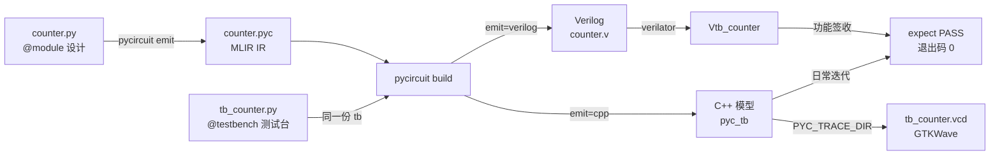
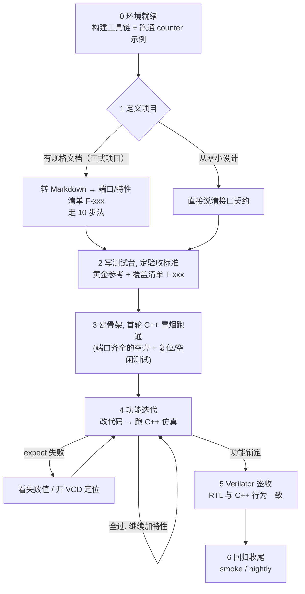

# 新手 Agent 操作指南：用自然语言驱动 pyCircuit 项目

本指南是一份**步骤导航**：用第 2 节的生命周期图和步骤表确定你在哪一步，再用第 3 节的说法指挥 Agent，细节看「参考」列的子文档。具体 bash 命令见 [Agent 命令参考](commands.md)，代码语法速查见[语法查找手册](primitives.md)。

## 1. 心智模型（先读 30 秒）

- **单一 IR、双后端、同一份测试台**：一次 build 生成 C++ 仿真器（`pyc_tb`，快）和 Verilator 仿真器（`Vtb_*`），它们执行同一组 `expect`。
- **日常功能验证只跑 C++**：`expect` 全过 = 退出码 0；Verilator 只是确认双后端一致的**签收**，不替代功能验证。
- **波形默认不写**：C++ 路设 `PYC_TRACE_DIR`；要让 Verilator 也出 VCD 用 `--trace-config`。
- 从规格文档起步的正式项目，完整设计与验证流程见 [10 步实现法](../pycircuit_implementation_method.zh.md)。

## 2. 开发步骤总览（新项目的完整时间线）

| 步骤 | 干什么 | 参考文档 |
|---|---|---|
| 0 环境就绪 | 建工具链，跑通 counter 示例（一次性） | [命令参考 §1–3](commands.md) |
| 1 定义项目 | 从规格走 10 步法（推荐），或小设计直接说接口 | [10 步实现法](../pycircuit_implementation_method.zh.md) · [XiangShan 实例](../../designs/XiangShan-pyc/docs/) · [tb_counter.py](../../designs/examples/counter/tb_counter.py) |
| 2 写测试台，定验收标准 | 对 Agent 说清**四样**：接口契约、逐周期行为、覆盖清单（F-xxx/T-xxx）、正确性参照（黄金参考＞规范表＞SVA＞随机+不变量）。激励/期望都是**构建时常数**；采样 `pre`=TICK-OBS / `post`=XFER-OBS | [TESTBENCH.md](../TESTBENCH.md) · [V6 Spec §9 仿真与测试](../v6_PyCircuit_Specification.md) · [语法手册 §12](primitives.md) · [Step 8](../pycircuit_implementation_method.zh.md) · [tb_bru.py 黄金模型范例](../../designs/XiangShan-pyc/backend/exu/tb_bru.py) |
| 3 实现与迭代 | 先搭骨架（空壳+复位/空闲测试），再逐特性加代码，只跑 C++ 仿真；每加特性重跑全部已有测试 | [命令参考 §4](commands.md) · [Step 9 增量纪律](../pycircuit_implementation_method.zh.md) |
| 4 迭代中看波形 | `PYC_TRACE_DIR` 开 VCD 定位；GTKWave 交互查看 | [命令参考 §5](commands.md) · [语法手册 §13](primitives.md) |
| 5 Verilator 签收 | 功能锁定后跑 RTL，确认与 C++ 一致 | [命令参考 §6](commands.md) |
| 6 回归收尾 | smoke 日常 / nightly 签收；失败定位 | [命令参考 §7–8](commands.md) · [DIAGNOSTICS.md](../DIAGNOSTICS.md) |

## 3. 推荐指令速查（直接发给 Agent）

| 场景 | 推荐说法 |
|---|---|
| 首次搭建 | 构建工具链，跑通 counter 双后端仿真，生成波形 |
| 新建项目 | 在 designs/examples 下新建 my_design 模块（说清端口/位宽/逐周期行为），配 @testbench，跑 C++ 仿真 |
| 从规格开始 | 按仓库 10 步实现法做：规格转 Markdown → 端口/特性清单 → 测试计划 → 增量实现 |
| 写测试台 | 帮我给 my_mod 写测试台：接口 clk/rst/enable/count[7:0]；复位 2 拍后 enable=1 时 count 每拍加 1 溢出回 0；覆盖复位值/计数 5 拍/保持/255→0；先跑 C++ smoke |
| 建骨架 | 帮我把 my_design 骨架搭起来：端口齐全的空壳设计 + 复位和空闲测试，先跑 C++ 冒烟 |
| 日常迭代 | 跑一下 counter 的 C++ 仿真，确认 expect 全过 |
| 换参数 | 用 width=16 参数重新构建并跑 C++ 仿真 |
| 看波形 | 跑一下 counter，开 VCD，告诉我波形里 count 怎么变 |
| 功能签收 | 功能已确认，用 Verilator 跑一遍验证 RTL 和 C++ 一致 |
| 失败排查 | C++ 仿真在 cycle 2 失败了，帮我定位是设计错还是测试台期望错 |
| 回归 | 跑仓库 smoke 回归，确认没破坏既有功能 |
| 出计划 | 这个任务分几步？先写一份带每步验收标准的计划，我确认后你再执行 |

## 4. 参考链接

- 具体命令、产物路径、环境变量、故障排查：[Agent 命令参考](commands.md)
- 写代码/审代码时查 primitive：[语法查找手册](primitives.md)
- 新项目正规实现路径：[10 步实现法](../pycircuit_implementation_method.zh.md)
- 报错解读：[DIAGNOSTICS.md](../DIAGNOSTICS.md)
- 本仓库约定：[AGENTS.md](../../AGENTS.md)
- pyc4.0 设计契约：[pyc4.0-decisions.md](../rfcs/pyc4.0-decisions.md)
- 官方教程：[v6_PyCircuit_Tutorial.md](../v6_PyCircuit_Tutorial.md)
- 测试台 API：[TESTBENCH.md](../TESTBENCH.md)
- CycleAwareTb 规范：[v6_PyCircuit_Specification.md §9](../v6_PyCircuit_Specification.md)
