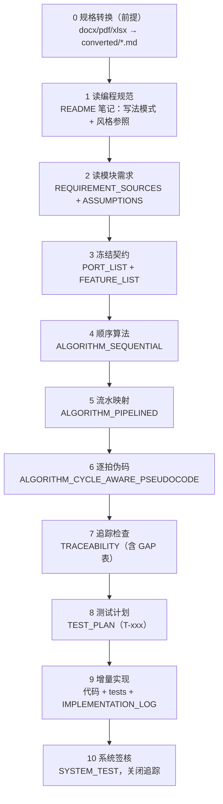
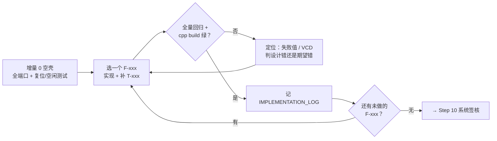

# 十步实现法使用指南：从规格文档到签核 RTL

本文件讲**十步实现法**怎么用：每一步干什么、产出什么、用户（你）在每一步审什么、迭代回路怎么转、每个落盘文件起什么作用。

- 主指南：[新手 Agent 操作指南](prompts.md) · 命令：[Agent 命令参考](commands.md) · 语法：[语法查找手册](primitives.md)
- **权威定义**：[10 步实现法](../pycircuit_implementation_method.zh.md)（方法论本身以它为准；本文件是用户视角的导读，不重复其条款）
- 完整实例：[LFSM 十步工作流流程图](../../designs/LFSM/pycircuit/report/十步工作流流程图_LFSM设计实例.md)（每步交付物 + GAP/增量实录）

## 1. 什么时候走十步法

| 项目类型 | 路径 |
|---|---|
| 有正式规格文档（docx/pdf/xlsx/md）的模块 | **十步法**（本文件） |
| 从零小设计 / 玩具示例 | 主指南 §2 轻量路径（直接说清接口契约） |

十步法的核心收益是**可审计的证据链**：任何一行实现能反查到规格标题，任何一条规格有测试兜底；代价是前期文档投入。模块越正式、参与的人和 Agent 越多，收益越大。

## 2. 十步内容总览

| 步骤 | 干什么 | 主要输出件 |
|---|---|---|
| 0 规格转换（前提） | 把 docx/pdf/xlsx 规格转成可搜索/diff 的 Markdown 工作副本 | `docs/converted/*.md`（带来源抬头） |
| 1 读编程规范 | 内化 V6 信号纪律、模块签名、子模块六步法 | 笔记（写明编写模式 + 风格参照示例） |
| 2 读模块需求 | 装载全部规范性输入，建需求→文档→章节来源表 | `REQUIREMENT_SOURCES.md`、`ASSUMPTIONS.md` |
| 3 冻结契约 | 端口/总线/位宽表；规格逐条拆成编号功能 | `PORT_LIST.md`、`FEATURE_LIST.md`（F-xxx + 标题核对表） |
| 4 顺序算法 | 命令式伪码（先不管周期和模块边界） | `ALGORITHM_SEQUENTIAL.md` |
| 5 流水映射 | 把算法对齐到时钟周期：每拍做什么、子模块边界、寄存器推导 | `ALGORITHM_PIPELINED.md` |
| 6 逐拍伪码 | 逐行可翻译成 V6 的完整伪码（含复位/空闲/反压） | `ALGORITHM_CYCLE_AWARE_PSEUDOCODE.md` |
| 7 追踪检查 | 证明覆盖：端口矩阵 + 功能矩阵 + 显式缺口 | `TRACEABILITY.md`（含 GAP 表） |
| 8 测试计划 | 每个端口、每项功能至少一条 T-xxx | `TEST_PLAN.md` |
| 9 增量实现 | 空壳 → 逐功能 → 测试 → 全量回归，循环 | 设计代码 + `tests/` + `IMPLEMENTATION_LOG.md` |
| 10 系统签核 | 组合场景压测；cpp 全绿后 verilator 一致 | `SYSTEM_TEST.md`；关闭 `TRACEABILITY` |

## 3. 用户怎么使用：你是审阅者，Agent 是执行者

十步法里用户的角色不是写文档，而是**在每一步的交付物上做签收**。推荐节奏是"逐步推进、逐步入账"：让 Agent 每完成一步就停下来，你审过交付物再放行下一步。

### 3.1 推荐说法（直接发给 Agent）

| 场景 | 推荐说法 |
|---|---|
| 启动 | 按仓库 10 步实现法做 designs/<Block>：先把规格转 Markdown，再逐步走，每步交付物写完停下来给我审 |
| 逐步推进 | 开始第 3 步，产出 PORT_LIST 和 FEATURE_LIST |
| 签收放行 | 第 3 步我确认，继续第 4 步 |
| 打回重做 | FEATURE_LIST 里 F-012 的触发条件和规格 §3.5 不符，改了再给我 |
| 规格变更 | 规格 xlsx 更新了，重新生成转写稿、更新标题核对表，把受影响的功能列成 GAP |
| 查进度 | 现在走到第几步？TRACEABILITY 里还有多少未关闭的 GAP？ |

### 3.2 每步签收时看什么

| 步骤 | 签收清单 |
|---|---|
| 0 转换 | 每个转写稿有来源抬头（原始文件/工具/已知缺口）；不完整的转换如实标注 |
| 1 规范 | 笔记写明"风格参照是哪份示例设计" |
| 2 需求 | 来源表能从每条需求反查到文档章节；`ASSUMPTIONS.md` 里每条 A-xxx 推断你都认可 |
| 3 契约 | 端口表冻结（位宽/方向/时钟域/相位）；标题核对表每一行都落到 F-xxx 或显式 "—" |
| 4–6 算法 | 伪码行为与你的理解一致；**周期划分（哪一拍做什么）你接受**——这是后面所有返工的根源 |
| 7 追踪 | GAP 表里每条未覆盖/偏差你都签字；**不允许静默省略** |
| 8 测试 | 每条 F-xxx 至少有一条"去掉该功能就失败"的回归敏感测试 |
| 9 实现 | 每个增量保持全量回归绿；`IMPLEMENTATION_LOG.md` 记录完整（日期/F-xxx/文件/命令） |
| 10 签核 | 签核标准（cpp 全绿 + verilator 一致）写进模块 README；`TRACEABILITY` 状态关闭 |

## 4. 迭代工作流

十步不是单向瀑布，实际运转有四条回路：

### 4.1 功能增量环（Step 9 的主循环）

- 依赖先行：先通数据通路，再引入反压/边角（LFSM 实例：I0 骨架 → I1 walker → … → I7 边界+背靠背）。
- 每个增量跑**全部**既有测试，不只跑新测试。
- 命令细节：[命令参考 §4](commands.md)（日常 C++ 迭代）、§5（VCD）、§8（失败定位）。

### 4.2 失败定位环（日常）

`expect` 失败 → 看失败值 / 开 VCD → 判**设计错还是测试台期望错** → 修 → 回归。涉及语义改动时遵守仓库纪律 **gate-first**：先加/改 MLIR 验证器或 pass，不在后端单独修补（见 `AGENTS.md`）。

### 4.3 规格演进环（规格不是化石）

规格更新 → 重跑转换脚本 → 标题核对表 diff → 新增/修改 F-xxx → `TRACEABILITY` 登记 → `TEST_PLAN` 补 T-xxx。**先改代码后补文档要走显式队列**（candidate → 用户授权 → freeze & sync docs），不允许静默漂移。

### 4.4 设计返工环（必要时回上游）

时序不达标或流水划分不合理 → 回 **Step 5** 重议周期划分，再顺流更新 Step 6/7/8 的伪码、矩阵和测试。LFSM 的「边3 严格流水 + 发送段 req_sched」就是一次登记在案的 Step 5 返工（GAP-06/07）。

## 5. 每个输出件的作用

| 文件 | 步骤 | 作用 | 什么时候翻它 | LFSM 实例 |
|---|---|---|---|---|
| `docs/converted/*.md` | 0 | 规格的 Markdown 工作副本，可搜索/diff/引用 | 规格溯源；规格变更后重新生成 | 9 份需求源转写 |
| `REQUIREMENT_SOURCES.md` | 2 | 需求 → 文档 → 章节/工作表的来源表 | 问"这条需求是哪来的" | SRC-01…09 |
| `ASSUMPTIONS.md` | 2–3 | A-xxx 决策登记：规格没说清之处的推断与理由 | 问"为什么这么设计" | A-001…A-014（首访去重、队列深度…） |
| `PORT_LIST.md` | 3 | 冻结的对外契约：端口/位宽/时钟域/协议相位 | 接线、写测试台、跨模块对齐 | 65 个端口 key |
| `FEATURE_LIST.md` | 3 | F-xxx 编号功能 + 规格全标题核对表；**定义"每一项功能"** | 范围核对、排期、漏项检查 | 44 个 F-xxx |
| `ALGORITHM_SEQUENTIAL.md` | 4 | 无周期的命令式行为伪码 | 新人理解"这个模块做什么" | walker/rdgen/asm/arb 伪码 |
| `ALGORITHM_PIPELINED.md` | 5 | 周期映射、子模块边界、寄存器/深度估算 | 时序讨论、划分返工的基准 | cycle-0 组合 / cycle-1 提交 |
| `ALGORITHM_CYCLE_AWARE_PSEUDOCODE.md` | 6 | 逐行可译 V6 的最终蓝图 | 写码前对照、代码 review 对照 | 每带状态叶模块恰好 1 次 `domain.next()` |
| `TRACEABILITY.md` | 7 | 端口矩阵 + 功能矩阵 + GAP 缺口表 | 证明覆盖；签核前必须关闭 | GAP-01…07（含 2 条已登记规格偏差） |
| `TEST_PLAN.md` | 8 | T-xxx 逐条测试计划（reset/smoke/directed/stress/corner） | 测试完备性核对 | T-001…T-103 |
| `IMPLEMENTATION_LOG.md` | 9 | 增量日志：日期、F-xxx、改动文件、命令 | 回溯某次改动、写周报 | I0–I7 全记录 |
| `SYSTEM_TEST.md` | 10 | 系统场景 + 签核命令与标准 | 最终签收 | TYPICAL 全向量回归 + verilator sign-off |
| `workflow_substeps.md` / `cycle_budget.md` / `stepN.md` | 可选 | 大模块的本地细化（子步骤、拍数预算） | 复杂模块按需 | LFSM 未用，XiangShan 用 stepN 标记 |

## 6. 与其他指南的关系

- 十步法 = 主指南 §2 中"有规格文档（正式项目）"分支的完整展开：[操作指南](prompts.md)
- 每一步的具体 bash 命令、产物路径、失败定位：[Agent 命令参考](commands.md)
- 写代码/审代码时的 primitive 速查：[语法查找手册](primitives.md)
- 方法论条款、交付物定义、Markdown 优先规则：[10 步实现法（权威）](../pycircuit_implementation_method.zh.md)
